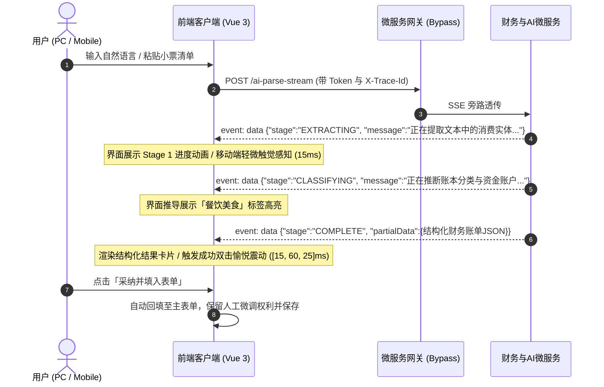

# 📱 前端全栈实践：基于 Vue 3 + SSE 流式打字机的多端 AI 智能记账系统设计

> **作者**：Alex
> **专栏**：微服务架构实战与 AIGC 智能落地
> **关键词**：Vue 3、TypeScript、Server-Sent Events (SSE)、打字机交互、移动端悬浮球、Web Haptics 触觉反馈、智能记账
> **阅读时长**：约 15 分钟

---

@[TOC](目录)

---

## 1. 为什么“传统记账软件”总让人半途而废？

做过记账或个人财务系统的开发者都知道，记账软件面临的最大宿命就是——**用户的“弃坑率”极高**。

究其核心根因，是**极度繁琐的表单录入阻力**：
记一笔简简单单的聚餐支出，用户需要经历：
1. 打开页面点击新建；
2. 弹出日期控件选择昨天；
3. 在几十个级联分类中翻找「餐饮美食 ➔ 晚餐聚会」；
4. 切换到数字键盘输入 `128.5`；
5. 在下拉列表中翻选支付账户「微信支付」；
6. 费劲打字输入备注「麦当劳套餐」；
7. 最终点击保存。

一次记账需要至少 **7~8 次点击与界面跳转**，一旦遇到长长的一张超市购物小票或多笔消费，手动录入更是反人类！

**解决之道：AI 驱动的极简自然语言与小票图文入账。**
用户只需要发一句话：“*昨天中午和同事聚餐微信付了128.5，麦当劳汉堡*”，或者直接粘贴一张超市小票明细，系统即可通过大模型自动提取意图、推断财务分类、核算金额并生成结构化账单草稿。

本文将深度解析如何在 **PC 端（Ant Design Vue）** 与 **移动端（Vant 4）** 打造一套**多阶段流式打字机 + Web Haptics 触觉感知 + 一键采纳回填**的企业级全栈智能记账交互系统。

---

## 2. 系统交互全景与多阶段流式协议设计

大模型的推理生成往往需要 2~5 秒。如果前端采用传统的单次 HTTP POST 请求，用户在点击后将面对数秒毫无反馈的“空白转圈”，体验极差。

为此，我们基于 **Server-Sent Events (SSE)** 制定了**多阶段进度通知协议（Multi-stage Progress Protocol）**：



---

## 3. 前端 SSE 核心流式客户端实现

许多同学在前端接入 SSE 时往往习惯使用浏览器原生的 `EventSource` API，但原生 `EventSource` 有一个致命限制：**仅支持 GET 请求，无法在 Request Body 中携带长篇小票文本或自定义 Header（如 Authorization Token）！**

在本项目中，我们使用原生的现代 `fetch` API 搭配 `ReadableStreamDefaultReader`，实现了灵活且健壮的通用流式解析器：

```typescript
// src/views/selfFinance/financeManager/api/index.ts

export interface UniversalFinanceAiStageVo {
    stage: 'EXTRACTING' | 'CLASSIFYING' | 'COMPLETE' | 'FAILED';
    message?: string;
    partialData?: UniversalFinanceAiParseVo;
}

export async function parseUniversalFinanceLedgerStream(
    params: UniversalFinanceAiParseReq,
    callbacks: {
        onStage?: (stageVo: UniversalFinanceAiStageVo) => void;
        onComplete?: (result: UniversalFinanceAiParseVo) => void;
        onError?: (err: Error) => void;
    },
): Promise<void> {
    const rawUrl = baseService.finance + '/financeManager/ai-parse-stream';
    const { useUserStore } = await import('@/store/modules/user/user');
    const token = useUserStore().getToken;

    try {
        const response = await fetch(rawUrl, {
            method: 'POST',
            headers: {
                'Content-Type': 'application/json',
                ...(token ? { Authorization: token } : {}),
            },
            body: JSON.stringify(params),
        });

        if (!response.ok) {
            throw new Error(`HTTP error! status: ${response.status}`);
        }

        const reader = response.body?.getReader();
        if (!reader) throw new Error('ReadableStream not supported.');

        const decoder = new TextDecoder('utf-8');
        let buffer = '';

        while (true) {
            const { done, value } = await reader.read();
            if (done) break;

            buffer += decoder.decode(value, { stream: true });
            const lines = buffer.split('\n');
            // 保留最后一个可能未分块完整的行
            buffer = lines.pop() || '';

            for (const line of lines) {
                const trimmed = line.trim();
                if (trimmed.startsWith('data:')) {
                    const jsonStr = trimmed.substring(5).trim();
                    if (!jsonStr) continue;

                    try {
                        const stageVo = JSON.parse(jsonStr) as UniversalFinanceAiStageVo;
                        callbacks.onStage?.(stageVo);

                        if (stageVo.stage === 'COMPLETE' && stageVo.partialData) {
                            callbacks.onComplete?.(stageVo.partialData);
                        }
                    } catch {
                        // 忽略心跳包或非 JSON 字符帧
                    }
                }
            }
        }
    } catch (err: any) {
        callbacks.onError?.(err);
    }
}
```

---

## 4. 移动端特色深度实践：悬浮球、抽屉与 Web Haptics 触觉系统

移动端屏幕寸土寸金，且手势操作频繁。我们打造了三大专属微交互体系：

### 4.1 自由拖拽与边缘吸附发光悬浮球（`MobileAiFloatingBubble.vue`）

在移动端记账主屏上，用户需要随时唤出 AI 助手，我们封装了支持手指 Touch 拖拽、松手自动吸附屏幕左右边缘的发光灵动球：

```vue
<!-- components/MobileAiFloatingBubble.vue 核心手势逻辑 -->
<script setup lang="ts">
import { ref, computed } from 'vue';
import { triggerHaptic } from '@/utils/haptics';

const isDragging = ref(false);
const posX = ref(window.innerWidth - 68);
const posY = ref(window.innerHeight - 180);

const onTouchStart = () => {
    isDragging.value = true;
    triggerHaptic('selection'); // 轻微选中震动
};

const onTouchMove = (e: TouchEvent) => {
    const touch = e.touches[0];
    posX.value = touch.clientX - 26;
    posY.value = touch.clientY - 26;
};

const onTouchEnd = () => {
    isDragging.value = false;
    // 自动吸附左右两侧
    const screenWidth = window.innerWidth;
    posX.value = posX.value < screenWidth / 2 ? 16 : screenWidth - 68;
    triggerHaptic('light');
};
</script>
```

---

### 4.2 Web Haptics：给大模型交互注入“真实物理手感”

这是整个系统最惊艳的细节设计。纯视觉的打字机容易让人产生视觉疲劳，借助浏览器原生的 `navigator.vibrate`（Web Haptics API），我们为大模型的各阶段生成赋予了**层次分明的触觉韵律**：

```typescript
// src/utils/haptics/index.ts

export type HapticType =
    | 'selection' // 键盘输入、单选切换 (轻微 10ms)
    | 'light'     // 选项点击、阶段推进入账 (轻快 15ms)
    | 'medium'    // 抽屉展开、浮层调出 (适度 30ms)
    | 'success'   // 识别完成、记账成功 (愉悦双击 [15, 60, 25]ms)
    | 'warning'   // 超支警告、未填项提醒 ([30, 80, 30]ms)
    | 'error';    // 请求失败、严重错误 ([50, 100, 50, 100, 50]ms)

export const triggerHaptic = (type: HapticType = 'light'): boolean => {
    if (typeof navigator === 'undefined' || !navigator.vibrate) {
        return false;
    }
    try {
        switch (type) {
            case 'selection': return navigator.vibrate(10);
            case 'light':     return navigator.vibrate(15);
            case 'medium':    return navigator.vibrate(30);
            case 'success':   return navigator.vibrate([15, 60, 25]);
            case 'warning':   return navigator.vibrate([30, 80, 30]);
            case 'error':     return navigator.vibrate([50, 100, 50, 100, 50]);
            default:          return navigator.vibrate(15);
        }
    } catch {
        return false;
    }
};
```

#### 在移动端流式回调中赋予生命力：
- 当识别进度推进一步时：`triggerHaptic('light')`；
- 当大模型成功将小票拆解完成、吐出结构化账单卡片时：触发 **`triggerHaptic('success')` 愉悦双震**！
- 用户的手机在手心里给出一声短促有力的清脆震动反馈，记账不再是冰冷的操作，而是具有高度确定感的交互。

---

### 4.3 记账交互抽屉与一键采纳（`FinanceAiSheet.vue`）

在弹出的 ActionSheet 中，用户既可以直接输入文字，也能一键点击上方提供的快捷胶囊（如「聚餐微信付128.5」、「超市小票清单」）：

```vue
<!-- 采纳回填主表单 -->
<van-button
    type="primary"
    block
    round
    icon="passed"
    class="apply-btn"
    @click="handleApply"
>
    采纳并填入记账表单
</van-button>
```

当点击「采纳」后，子组件通过事件通知宿主页面：
```typescript
const handleApply = () => {
    if (!parsedResult.value) return;
    triggerHaptic('success');
    emit('apply', parsedResult.value);
    visible.value = false;
};
```
宿主页面的金额、账本所属人、消费分类、日期、关联预付卡等表单项被瞬间自动对齐，用户扫一眼无误直接提交，**记账耗时从 30 秒压缩至 2 秒以内**！

---

## 5. PC 端沉浸式模态设计（`FinanceAiParseModal.vue`）

在 PC 端管理后台，我们使用 Ant Design Vue 打造了沉浸式两栏对比解析框：
1. **左侧输入栏**：支持自然语言粘贴、多格式小票导入；
2. **右侧实时预览区**：
   - 动态 Stage 步骤条指示器；
   - 实体置信度评分徽章（Confidence Badge，如 `98% 准确率`）；
   - 购物小票项目明细表（名称、单价、数量、总计）；
3. **安全闭环**：结合全链路 TraceId 追踪（参见专栏上一篇 [《分布式全链路 TraceId 穿透实战》](https://blog.csdn.net/qq_40181007/article/details/168561045)），如果用户输入了异常账单或者触发了大模型风控，可秒级溯源。

---

## 6. 总结与实践成效

通过这一套多端 AI 智能记账体系：
1. **录入效率飞跃**：单笔账单录入点击次数由平均 7.5 次降低为 **1 次（一键采纳）**；
2. **多端协同**：一套 SSE 协议后端契约，同时支撑 PC 端大屏精细核算与移动端极速随手记；
3. **微交互质感**：结合 Web Haptics 触觉震动与自适应悬浮球，极大消除用户日常记账的枯燥感；
4. **人工兜底原则**：AI 永远作为“协作者（Copilot）”，生成草稿而不越权直接静默入库，给用户百分之百的掌控感。

---

## 🎨 本文专属封面生图提示词与设计指南

### 1. 封面建议排版大字（建议在 Canva / 稿定设计制作）
- **主标题**：**Vue 3 双端 AI 智能记账**
- **副标题**：*自然语言结构化 · SSE 流式打字机 · 触觉感知*
- **推荐字号/配色**：清新翡翠绿与科技亮白粗体字体，搭配立体柔和阴影

### 2. 中文生图提示词（适用智谱清言、即梦、通义万相、Liblib 等）
> 现代扁平与 3D 结合的技术封面，悬浮的发光电脑屏幕与轻薄智能手机并排展示（PC 与移动端），空中漂浮着纸质消费小票和日常聊天气泡，被彩色的 AI 流式粒子光带转化为立体的发光金币、记账图表和精美分类徽章，清新极简科技风，翡翠绿与科技蓝渐变，柔和演播室光影，C4D 渲染，高精细节，16:9 比例。

### 3. 英文 Prompt（适用 Midjourney v6 / DALL-E 3）
```text
16:9 modern tech banner, a sleek laptop display and a floating smartphone side by side, paper shopping receipts and chat speech bubbles dissolving into glowing stream particles and reforming into 3D colorful coins, category badges, and clean financial ledger cards, emerald green and electric cyan gradient, soft studio lighting, C4D and Blender clay render, minimal aesthetic, premium UI UX concept --ar 16:9 --style raw --v 6.0
```
