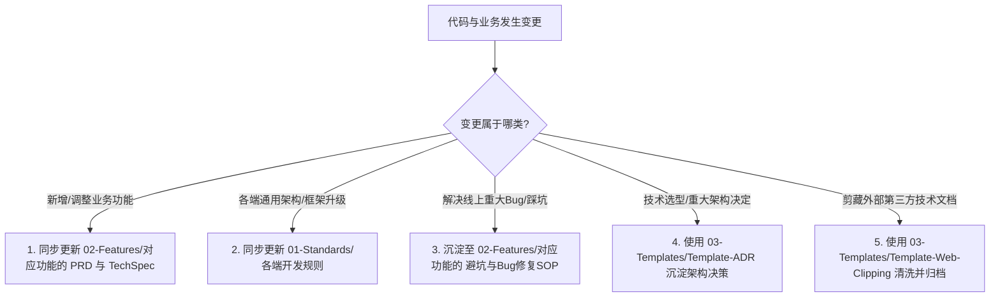

# 🔄 知识库持续维护与代码同步 SOP

返回导航：[[Home|知识库首页]]

---

## 1. 核心契约原则 (Core Contract)

> [!IMPORTANT]
> **代码与知识库双向同步原则**：
> 知识库 `my_alex_brain` 是项目全生命周期唯一可信的业务与技术真实之源（Source of Truth）。
> **凡涉及代码中的业务规则、数据模型、API 契约、页面交互逻辑或运维配置修改，必须在交付代码的同时，同步更新 `my_alex_brain` 对应目录下的文档！**

---

## 2. 场景化同步映射指南



### 2.1 变更场景与对应更新文件映射表

| 代码变更场景 | 对应模块/端 | 知识库必须同步更新的路径 |
| :--- | :--- | :--- |
| **新增/修改业务字段或表结构** (如 Gift 增加字段、Notice 渠道表) | `alex_miaosha_finance` | • `02-Features/对应功能/PRD-*.md`<br>• `02-Features/对应功能/TechSpec-*.md` |
| **PC 端新增/调整页面与交互** (Tailwind CSS、抽屉组件、状态) | `alex_miaosha_front` | • `01-Standards/PC端开发规则与组件范式.md`<br>• `02-Features/对应功能/PRD-*.md` |
| **移动端交互/触觉/视口调整** (Haptic、NavBarConfig) | `alex_miaosha_mobile` | • `01-Standards/移动端开发规则与适配规约.md`<br>• `02-Features/对应功能/PRD-*.md` |
| **权限规则/数据隔离逻辑调整** (DataPermission、UserUtils) | `alex_miaosha_user` | • `02-Features/02-RBAC-用户组织权限/TechSpec-*.md`<br>• `01-Standards/后端微服务开发规则与运维规约.md` |
| **通用基础设施底座增强** (RateLimiter、多级缓存、Druid池) | `alex_miaosha_common` | • `01-Standards/后端微服务开发规则与运维规约.md`<br>• `00-System/对应技术分享与架构文档` |
| **新增微服务或端口变更** | 全局网关/运维 | • `00-System/全栈系统架构总览与交互流.md`<br>• `01-Standards/后端微服务开发规则与运维规约.md` |
| **修复复杂竞态/缓存/安全 Bug** | 全端通用 | • `02-Features/对应功能/避坑与Bug修复SOP/` 沉淀复盘 SOP |
| **引入外部三方 API/技术文档** (微信开放平台、DeepSeek 等) | 外部输入 | • `04-Attachments/External-Docs/` 归档清洗后的文档 |

---

## 3. AI Agent 与开发者工作流约束

每次 AI Assistant 或开发团队完成功能迭代时，必须执行 **闭环检查**：
1. **代码与单测实现**（满足功能与测试覆盖率，后端 9 项 IT、前端 type-check 0 error）；
2. **测试清单沉淀**（更新 `tests/checklists/{feature}.md`）；
3. **知识库文档同步**（检查 `my_alex_brain` 对应需求/开发文档是否同步更新，版本日期置为最新）；
4. **Git 提交纪律**：仅当用户明确说「git提交代码」时才执行 commit + push，严禁未经许可自动提交。

---

## 4. Obsidian 双链与 Markdown 编写规约 (自包含与多端一致性)

为确保知识库在不同电脑、不同客户端（Obsidian、VS Code、Cursor、Antigravity）以及不同 AI Agent 环境中均能无歧义解析与关联，必须严格遵守以下排版与链接规约：

### 4.1 强制标准双链（Wikilinks）
- **唯一合法语法**：统一采用 `[[目录/文件名|显示别名]]` 或 `[[文件名]]`。
  - 正确示例：`[[01-Standards/后端微服务开发规则与运维规约|后端开发规约]]`
  - 严禁格式：禁止使用普通 Markdown 超链接 `[后端规约](01-Standards/xxx.md)` 或绝对路径 `[后端规约](file:///F:/...)`，否则会导致 Obsidian 图谱关系网（Graph View）和反向链接（Backlinks）断裂。
- **防幻觉校验**：AI 在添加双链前，必须先比对库内已有文件目录，严禁指向不存在的孤岛页面。

### 4.2 统一 YAML Frontmatter 属性
所有新建与更新的文档头部必须包含标准 Frontmatter 元数据：
```yaml
---
title: "文档标题"
aliases: [别名1, 别名2]
created: YYYY-MM-DD
updated: YYYY-MM-DD
status: active # 可选: active | draft | deprecated
tags: [system, feature, standard, template]
---
```

### 4.3 Callout 高亮块规约
统一使用 GitHub / Obsidian 标准 Callout 语法：
- `> [!NOTE]`：背景说明、设计思路与实现细节
- `> [!TIP]`：最佳实践、开发效率优化与技巧
- `> [!IMPORTANT]`：核心契约、必须严格遵守的铁律
- `> [!WARNING]`：破坏性变更、兼容性风险与易踩坑点
- `> [!CAUTION]`：高危操作、数据丢失或安全漏洞警告

---

## 5. 外部资料与网页清洗规范 (Defuddle 网页降噪与剪藏 SOP)

当需要将外部官方技术文档（如微信公众平台模板消息接口、MyBatis-Plus 最佳实践、DeepSeek API 规约等）沉淀入知识库时，严禁直接抓取全量 HTML 裸存，必须经过结构化清洗以剔除噪声、节省大模型 Token 消耗。

### 5.1 网页清洗三原则
1. **彻底剔除无用噪声**：清洗掉页面顶部导航栏、广告横幅、页脚版权、Cookie 弹窗、侧边栏推荐列表与冗余脚本样式；
2. **保留语义化结构**：完整保留标题层级（H1~H4）、核心代码块（带语言标识，如 `json`, `java`, `typescript`）、关键参数表格与核心说明；
3. **建立反向业务连接**：清洗后的外部文档必须在开头声明其服务的内部业务模块（例如：微信模板消息文档必须双链回 `[[02-Features/09-Message-系统消息与到期提醒中心/TechSpec-系统消息与业务到期巡检架构设计|消息中心TechSpec]]`）。

### 5.2 归档存放位置
- 清洗后的外部文档一律存放于：`04-Attachments/External-Docs/{YYYY-MM}-{文档主题}.md`；
- 使用模板：`03-Templates/Template-Web-Clipping.md`。

### 5.3 跨机器通用网页清洗 Prompt (零环境依赖)
在未安装特定 CLI 工具的其他电脑上，任何 AI Agent 均可使用以下 Prompt 模版直接执行高质量清洗：

> [!TIP]
> **网页清洗系统 Prompt 模板**：
> ```markdown
> 你是一个专业的技术文档网页清洗专家。请将用户提供的外部网页原始文本或 HTML 清洗为纯净的 Obsidian 风格 Markdown 文档，规则如下：
> 1. 彻底剔除导航栏、页眉页脚、广告、登录框、免责声明等与技术正文无关的噪声；
> 2. 提取出精准标题与清晰的目录层级，保留完整的代码块与 API 参数表格；
> 3. 头部生成符合知识库规范的 YAML Frontmatter（source_url、title、clipped_date、tags: [external-doc, api-ref]）；
> 4. 结尾追加关联提示：注明该外部文档在本项目中支撑哪一个业务胶囊或工程规约。
> ```

---

## 6. 跨机器/多环境可移植性红线 (Portable Vault)

为确保知识库被克隆到任何新机器（无论是 Windows、macOS 还是 Linux）都能无缝运转：

1. **绝对路径零容忍**：
   - 知识库内部文档**严禁出现任何特定电脑的盘符或绝对路径**（如 `D:\project\...` 或 `F:\workplace\...`）；
   - 所有引用一律采用 Obsidian 双链 `[[...]]` 或库内相对路径。
2. **Git 版本控制忽略策略**：
   - **必须纳入 Git 追踪**：所有 `.md`、`.canvas` 文件，以及 `.obsidian/community-plugins.json`、`.obsidian/core-plugins.json`、`.obsidian/app.json`（保持各端插件与快捷键一致）；
   - **必须忽略（.gitignore）**：`.obsidian/workspace.json`（避免多台设备分辨率、侧边栏折叠状态冲突产生无休止的 Merge Conflict）。
