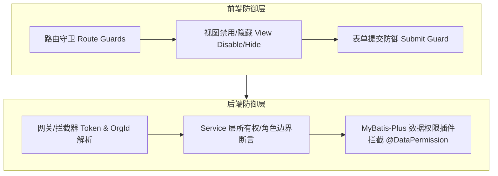

# 数据权限与越权防御规约 (RBAC & Multi-Tenant Isolation Standard)

> **版本**：v1.0.0  
> **更新时间**：2026-10-15  
> **适用范围**：后端微服务（alex_miaosha_*）、PC端管理后台（alex_miaosha_front）、移动端H5（alex_miaosha_mobile）

---

## 一、核心原则与防御层级

系统严格遵循**“纵深防御（Defense in Depth）”**与**“最小权限原则（Principle of Least Privilege）”**，在前端视图、前端路由、后端网关、业务服务层与数据访问层构建五道防线：



---

## 二、角色模型与权限定义矩阵

| 角色代码 (`roleCode`) | 角色名称 | 机构隔离范围 (`org_id`) | 行级数据归属 (`belong_to` / `user_id`) | 零花钱预算权限 | 流水操作权限 |
| :--- | :--- | :--- | :--- | :--- | :--- |
| `super_super` / `super_admin` | 超级管理员 | 全局直通（不限机构） | 全量可见与可操作 | 可查询、可配置、可保存 | 全员流水可勾选、可编辑、可删除 |
| `family_admin` | 家庭管理员 | 限定本人所在有效机构 (`userUtils.getOrgId()`) | 本机构全员流水可见；可代管同机构成员流水 | 可查询、可测算、可保存 | 本机构全员流水可勾选、可编辑、可删除 |
| `family_member` | 普通家庭成员 | 限定本人所在有效机构 (`userUtils.getOrgId()`) | 仅本人流水可编辑/删除；同机构成员流水只读 | 仅浏览模式；禁止保存与修改 | 仅本人流水可勾选、编辑、删除；他人复选框置灰禁选 |

---

## 三、前端防御规约 (PC & Mobile)

### 1. 列表与行级操作防御
- **复选框 (`Checkbox`)**：
  - 非管理员视角下，若数据行 `record.belongTo !== currentUser.id`，复选框必须显式设置 `:disabled="true"`，禁止触发批量删除。
  - 必须挂载语义化测试桩 `data-testid="row-select-{id}"`。
- **操作列按钮 (`Edit` / `Delete`)**：
  - 非管理员且非本人数据行，禁止渲染编辑与删除按钮，或渲染置灰不可点击的禁用态。
  - 必须挂载语义化测试桩 `data-testid="btn-edit-finance"`、`data-testid="btn-delete-finance"`。

### 2. 预算管理弹窗 / 独立页面只读防御
- **权限计算**：
  - PC 端：`const { hasPermission } = usePermission(); const canEditBudget = computed(() => hasPermission('finance:financeManager:budget:edit'));`
  - 移动端：`const canEditBudget = computed(() => hasPermission('finance:financeManager:budget:edit'));`
- **只读态渲染规范**：
  - 顶部显著展示只读警示横幅：
    - PC 端：`<a-alert message="家庭成员浏览模式，仅家庭管理员可调整月度预算设定" data-testid="budget-readonly-alert" />`；
    - 移动端：`<div class="readonly-notice-banner"><van-icon name="info-o" /><span>家庭成员浏览模式，仅家庭管理员可调整月度预算设定</span></div>`。
  - 金额输入框：
    - PC 端：`<a-input-number :disabled="!canEditBudget" />`；
    - 移动端：`<van-field :readonly="!canEditBudget" data-testid="input-budget-amount" />`。
  - 提交动作防护：
    - 非管理员视角下，必须从 DOM 中完全隐藏保存按钮（`v-if="canEditBudget"`），仅保留“取消”或“返回列表”按钮。
    - 方法内部双重防线：`if (!canEditBudget.value) return;` 阻断非法直接调用。

---

## 四、后端服务层越权防御规约 (Finance & Common)

### 1. 跨机构 (Cross-Tenant / Cross-Org) 越权校验
```java
private Long resolveTargetOrgId(Long orgId) {
    Long userOrgId = userUtils != null ? userUtils.getOrgId() : null;
    if (userUtils != null) {
        TUserVo user = userUtils.getLoginUser();
        if (user != null && !isSuper(user)) {
            if (orgId != null && userOrgId != null && !userOrgId.equals(orgId)) {
                throw FinanceException.forbidden("无权访问其他机构数据");
            }
        }
    }
    if (orgId != null) {
        return orgId;
    }
    return userOrgId != null ? userOrgId : 20L;
}
```
- **关键规则**：
  1. 绝不允许客户端任意传入 `orgId` 即可跨租户查写数据；
  2. 非超管用户必须比对客户端传入 `orgId` 与会话解析的 `userUtils.getOrgId()`，不一致一律抛出 `FinanceException.forbidden("无权访问其他机构数据")`。

### 2. 写操作权限边界断言
```java
private void assertCanEditBudget() {
    if (userUtils == null) return;
    TUserVo user = userUtils.getLoginUser();
    if (user == null) return;
    if (isSuper(user) || isFamilyAdmin(user) || hasBudgetEditPermission(user)) {
        return;
    }
    throw FinanceException.forbidden("无权保存预算设定，仅家庭管理员可操作");
}
```
- **关键规则**：
  1. 涉及全家庭/全机构配置的操作（如家庭预算设定），必须校验是否拥有管理员角色或显式按钮权限编码（`finance:financeManager:budget:edit`）；
  2. 未授权调用直接阻断，禁止穿透到底层 Mapper。

---

## 五、自动化测试验证与守护要求

所有涉及多角色或多租户的业务模块，在交付前必须通过测试金字塔三层验证：

1. **后端集成测试 (`*OwnershipIT.java`)**：
   - 必须包含跨机构查询越权拦截用例（`should_reject_cross_org_*_query`）；
   - 必须包含跨机构写操作越权拦截用例（`should_reject_cross_org_*_save`）；
   - 必须包含角色权限边界拦截用例（`should_reject_member_without_*_permission`）；
   - 必须包含授权放行正向用例（`should_allow_same_org_family_admin_to_manage_*`）。
2. **PC 端 AI Smoke (`pnpm test:ai:smoke`)**：
   - 采用多 Persona 动态切换，覆盖 `family_member`（他人行置灰、无保存按钮、只读横幅）与 `family_admin`（全选、可编辑）矩阵。
3. **移动端 AI Smoke (`pnpm test:ai:smoke`)**：
   - 校验移动端普通成员入口展示“预算详情”、进入页面展示 `.readonly-notice-banner`、输入框为 readonly、无保存按钮。
