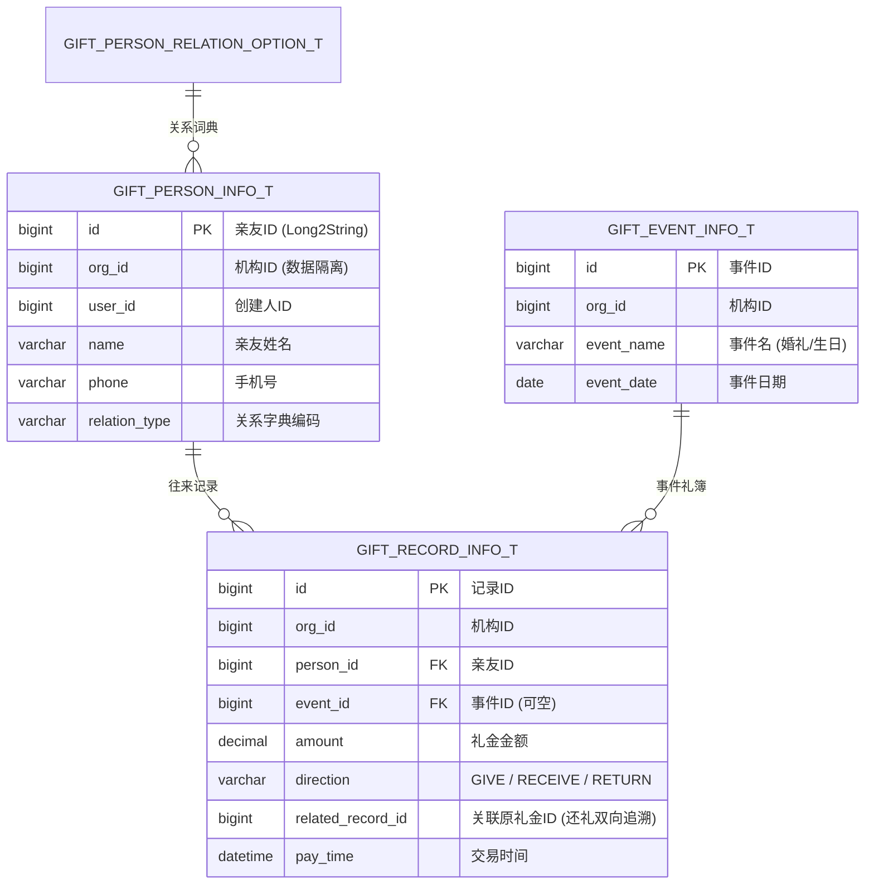

# 💻 TechSpec - 礼尚往来业务领域模型与契约

返回导航：[[Home]] | 功能描述：[[02-Features/01-Gift-礼尚往来/PRD-礼尚往来与人情记账功能说明|PRD-礼尚往来与人情记账功能说明]]

---

## 1. 架构领域划分与三表模型

礼尚往来微服务位于 `alex_miaosha_finance`，按 `record`、`person`、`event` 三大子域分包：



---

## 2. 核心技术设计

### 2.1 10w+ 级复合索引设计
```sql
ALTER TABLE gift_record_info_t ADD INDEX idx_org_user_paytime (org_id, user_id, pay_time);
ALTER TABLE gift_record_info_t ADD INDEX idx_org_person_direction (org_id, person_id, direction);
ALTER TABLE gift_record_info_t ADD INDEX idx_related_record_id (related_record_id);
```

### 2.2 数据权限与安全规约
- Mapper 查询必须显式标注 `@DataPermission(tableAlias = "t", userColumn = "user_id", orgColumn = "org_id")`；
- 严禁调用 MyBatis-Plus 默认的 `service.page()` 查询礼金数据（详见对应避坑 SOP）。

### 2.3 历史菜单彻底下线与全量收敛 (2026-09-19)
- **历史演进**：系统早期在「个人财务」(`selfFinance`) 下挂载了单表维度的「个人随礼信息」(`personalGift`, `/selfFinance/personalGift`)。随着「礼尚往来管理」(`gift`, `/finance/gift`) 完整领域模型（三表 + 数据概览 + 亲友 + 事由 + 礼金 + 统计）上线，老菜单已完全被新体系覆盖；
- **下线清理**：于 2026-09-19 对 `t_menu_info` (IDs: 1810856881968091138, 1810856882504962050) 及对应权限、角色关联彻底执行逻辑删除，清理 Redis 缓存并移除前端废弃组件目录 `alex_miaosha_front/src/views/finance/personalGift/`。

### 2.4 Picker 级动态新建与自动回填契约 (2026-09-24)
- **问题与场景**：在「快速记礼」等高频录入抽屉中，用户点击「+ 新建外部联系人」唤起 `gift-person-detail` 弹窗创建人员。
- **契约标准**：
  1. `gift-person-detail` 必须在保存成功时触发 `emit('success', resultPerson)` 传递新增的人员实体对象（含生成的 Long/String ID）；
  2. `gift-contact-picker` / `gift-person-picker` 监听 `success` 事件后，立即将该联系人注入本地 options 并将 `modelValue.value` 自动设为 `String(person.id)`；
  3. 自动触发父级（如抽屉）的 `watch` 获取画像统计，实现**零二次点击、即建即选**的无缝闭环体验。

### 2.5 AI 智能赋能与自然语言记账契约 (2026-09-29)
- **自然语言记账智能解析 (`POST ${api.version}/gift-record-info-t/ai-parse`)**：
  - 入参：`GiftRecordAiParseReq` (`content: String`, `defaultDirection: String`)；
  - 出参：`GiftRecordAiParseVo`（含 `personName`, `personId`, `isNewPerson`, `relationType`, `relationName`, `eventType`, `eventTypeName`, `amount`, `direction`, `payTime`, `location`, `remark`）；
  - 核心链路：调用 `ai_api` RPC（`AiAnalyzeApi#chat`，`bizType="gift-ledger-parse"`）提取结构化要素，并联动 `gift_person_info_t`、`gift_person_relation_option_t`、`gift_event_type_option_t` 自动匹配已有联系人及分类；若 AI 超时或不可用，无缝降级为本地正规正则与文化语义抽取保底。
- **智能礼金推荐理由与情景贺词 (`GET ${api.version}/gift-event-type-option-t/recommend-amount`)**：
  - 出参结构扩充：`GiftRecordRecommendAmountVo` 新增 `aiReasoning`（人情往来理由推理，结合往来历史对等性、吉利双数建议说明）与 `aiGreetingTip`（针对婚礼、乔迁、满月、寿宴等不同事由的得体贺词/祝福语）；
### 2.6 AI 端到端烟测与自动化验收基线 (2026-09-30)
- **移动端 AI 快速记账与贺词烟测 (`GIFT-AI-MOBILE-001`, `GIFT-AI-MOBILE-002`)**：
  - 测试用例定义于 `alex_miaosha_mobile/tests/midscene/gift/cases/mobile-ai-smoke.json`；
  - 运行命令：`pnpm test:ai:smoke`（执行 `scripts/playwright/run-mobile-ai-smoke.mjs`）；
  - 核心断言：
    1. 自然语言快速录入解析回填（金额 800、亲友 李四、事由 百日宴）；
    2. 智能推荐卡片与吉利贺词即时渲染（`data-testid="gift-record-ai-recommend-card"`）；
    3. 点击复制贺词触发剪贴板复制提示并激活触觉振动（`window.__hapticCallCount` 递增）；
  - 稳定性保障：基于 `installHapticProbe` 拦截 `navigator.vibrate`，配合网关 AES-128-CBC 统一加解密 Mock 与 `/api/am-` 路由隔离，支持 Chromium / Edge 多通道弹性降级启动。

### 2.7 移动端联系人详情页双模组件解耦 (2026-10-14)
- **背景痛点**：`giftPersonDetail/index.vue` 原为 1,140 行超大巨石单文件，混编了「Profile 档案画像展示」与「Edit/Add 资料表单」两套完全不同的视图及近 500 行样式；
- **架构重构**：
  1. `GiftPersonProfileView.vue`：独立承载 Hero 头像、脱敏手机号胶囊操作条、收送礼金统计卡片与往来历史明细；
  2. `GiftPersonEditForm.vue`：独立承载头像上传/清除、基础信息字段与校验、关系选项 Picker 联动弹窗及吸底保存；
  3. 主页面 `index.vue`：精简至 200 行以内的轻量控制器，专注于路由参数监听、双模切换与全局导航栏状态同步，全量单测与打包构建 0 报错。

### 2.9 PC 端 AI 快速记礼端到端验收与组件防御性重构 (2026-10-15)
- **PC 端 AI 快速记账烟测集成 (`AI-GIFT-PC-001`)**：
  - 测试用例定义于 `alex_miaosha_front/tests/midscene/rbac/cases/domain-ai-smoke.json`；
  - 运行命令：`pnpm test:ai:smoke`（执行 `scripts/playwright/run-domain-ai-smoke.mjs`）；
  - 覆盖场景：`#/finance/gift/record` 唤起快速记礼抽屉（`gift-record-open-drawer`）-> 输入自然语言快速记账内容（`gift-record-ai-input`）-> 点击智能解析（`gift-record-ai-btn`）-> 断言金额与事由自动回填（`gift-record-form-amount` 包含 800）；
  - 端口安全：规避默认 3000 端口本地冲突，统一弹性运行于 3100 端口。
- **组件入参防御性编程**：
  - `GiftRecordPartiesField.vue`、`GiftRecordAmountField.vue`、`GiftRecordEventField.vue` 统一使用 `withDefaults(defineProps<{...}>(), {...})` 并对数组属性添加 `(list?.length ?? 0) > 0` 保护；
  - `gift-org-member-picker` 与 `gift-person-picker` 的 `setOptions` 对入参统一执行 `(Array.isArray(list) ? list : []).forEach`，消除空对象或脏数据导致的 `forEach is not a function` 运行时白屏风险；
  - `useGiftRecordOptionsCache` 缓存加载器严格以 `Array.isArray()` 校验后端响应，确保前端缓存层健壮无污染。

### 2.10 后端领域模型七点法边界与数据权限加固 (2026-10-15)
- **金额上限与精度控制 (`GiftRecordInfoServiceImp`)**：
  - 金额七点法闭环：限制上限最大为 `9999999999.99`（DB `decimal(12,2)`），超过抛出业务异常友好拦截，消除 MySQL 500 级数据截断（Data Truncation）；
  - 小数精度规范化：针对 `scale > 2` 自动采用 `RoundingMode.HALF_UP` 截断四舍五入为两位小数。
- **实体基础字段防御与防呆 (`GiftPersonInfoServiceImp` / `GiftEventInfoServiceImp`)**：
  - `personName` 校验必填（1～50 字符，非空非纯空格），`phone` 校验长度 $\le 20$；
  - `eventName` 校验必填（1～100 字符，非空非纯空格）；
  - 事由主办人（`hostPersonId`）防越权绑定：若传入 `hostPersonId`，强制调用 `assertPersonAccessible` 校验其机构归属，杜绝跨机构冒领或数据渗透。
- **Analysis 聚合层空指针自愈 (`GiftAnalysisServiceImpl`)**：
  - `eventRanking` 与 `personRanking` 对分页返回记录集采用 `(page != null && page.getRecords() != null ? page.getRecords() : Collections.emptyList())` 守卫，杜绝空数据列表触发 NPE。
- **自动化集成测试护城河 (`*ServiceIT.java`)**：
  - `GiftRecordInfoServiceIT`（14 项用例）、`GiftPersonInfoServiceIT`（12 项用例）、`GiftEventInfoServiceIT`（11 项用例），覆盖参数越权、边界异常与 ORG_SHARED 数据隔离矩阵，全部 82 项用例 100% 绿灯。

### 2.6 SQL 唯一归口与零散文件清零规范 (2026-10-16)
- **严格单文件规约**：工程禁止在 `backend/alex_miaosha/doc/sql/` 下保留任何独立功能补丁脚本（如 `alex_finance_gift_management.sql` 已全量归口删除）；
- **模块数据库落点**：
  - 礼尚往来业务数据表（`gift_person_info_t`、`gift_event_info_t`、`gift_record_info_t`、`gift_person_relation_option_t`、`gift_event_type_option_t`、`gift_event_type_user_config_t`）全量收敛至 `backend/alex_miaosha/doc/sql/alex_finance.sql`；
  - 礼尚往来菜单、权限与角色（`gift:...`、`t_menu_info` 1900000000000001000 系列、`t_role_info` `gift_admin`/`gift_user`）全量收敛至 `backend/alex_miaosha/doc/sql/alex_user.sql`。

---

## 3. 关联方案与排错 SOP 导航
- 历史开发实施方案：
  - `02-Features/01-Gift-礼尚往来/历史开发方案/2026-05-14-gift-stitch-alignment.md`
  - `02-Features/01-Gift-礼尚往来/历史开发方案/2026-05-14-gift-stitch-alignment-design.md`
- 关联高危排错 SOP：
  - [[02-Features/01-Gift-礼尚往来/避坑与Bug修复SOP/避坑SOP-MyBatisPlus数据越权|避坑SOP-MyBatisPlus数据越权]]
  - [[02-Features/01-Gift-礼尚往来/避坑与Bug修复SOP/避坑SOP-亲友与事件查询入参契约断裂|避坑SOP-亲友与事件查询入参契约断裂]]
  - [[02-Features/01-Gift-礼尚往来/避坑与Bug修复SOP/避坑SOP-Vue组件Props数组防御与Playwright测试桩|避坑SOP-Vue组件Props数组防御与Playwright测试桩]]
  - [[02-Features/01-Gift-礼尚往来/避坑与Bug修复SOP/避坑SOP-端到端烟测弹窗遮罩拦截与移动端权限上下文断裂|避坑SOP-端到端烟测弹窗遮罩拦截与移动端权限上下文断裂]]


### 2.11 人情往来智能洞察报告与互赠收支平衡矩阵 (2026-10-20)

- **亲友互赠收支平衡矩阵 (GiftPersonBalanceVo)**：
  - 双向礼金差额对账：以亲友与关系圈层为维度，穿透核算 	otalReceiveAmount (TA送我)、	otalGiveAmount (我送TA) 与 
etBalance = Receive - Give；
  - 平衡状态机自动划分：SURPLUS（多收待回 / 礼金盈余）、DEFICIT（多送待收 / 礼金借出）、BALANCED（±200 元内基本持平）；
  - 人情失衡预警机制：净差额 ≥ 800 且超过 180 天未有往来互动时自动标定 isImbalancedAlert = true，提示适时体面回礼维护关系；
- **AI 智能回礼金额档位测算推荐器 (
ecommendReturnGift)**：
  - 算法规则引擎：综合历史互赠参考基准（取历史最高收礼金额或 500 保底）、事件类型加权（结婚 1.2、满月/寿宴 1.0、乔迁 0.95、白事 0.85）与亲疏关系加权（直系近亲 1.3、亲戚朋友 1.1、同事同学 1.0）；
  - 吉利档位阶梯映射：按民间传统吉利数字阶梯（200/500/600/666/800/888/1000/1200/1288/1688/1888/2000/2888/5000）向上归一化；
  - 输出三档金额建议（最低体面档、推荐平衡档、热络加码档），附带 AI 推导演算依据与定制祝颂语锦囊；
- **PC 端落地与交互**：
  - 在 src/views/finance/gift/analysis/index.vue 增加「亲友人情互赠平衡矩阵」面板，支持关系圈筛选与姓名搜索；
  - 点击操作列「AI 测算回礼」唤起 540px 独立抽屉 GiftReturnCalculatorDrawer.vue，支持一键切换事由测算、档位对比与一键复制贺词；
- **移动端落地与触觉赋能 (2026-10-20)**：
  - 在移动端 src/views/finance/gift/analysis/index.vue 新增平衡矩阵卡片列表，呈现亲友双向收支、差额胶囊及失衡预警条；
  - 封装移动端专用底部速算浮层 GiftReturnCalculatorPopup.vue，结合 Vant Popup 与手势流转；
  - 全流程融入触觉反馈：浮层调出（medium）、事由/城市圈切换（selection）、AI 测算成功（success）、失衡告警点击（warning）；
  - 数据护城河：引入 src/views/finance/gift/api/normalize.ts 纯函数，单测锁死 BigInt/Number 雪花 ID 字符串化契约；
- **质量与契约防护**：
  - 测试清单：	ests/checklists/gift-analytics.md；
  - 后端单测：GiftAnalysisBalanceMatrixTest.java 5 项用例 100% 绿灯；
  - PC 前端单测：giftAnalytics.test.ts 7 项用例 100% 绿灯，ue-tsc --noEmit 0 报错；
  - 移动端单测：giftMobileBalanceMatrix.test.ts 7 项用例 100% 绿灯，移动端全量 23 个测试文件 129 项用例 100% 绿灯，构建打包 0 报错。
