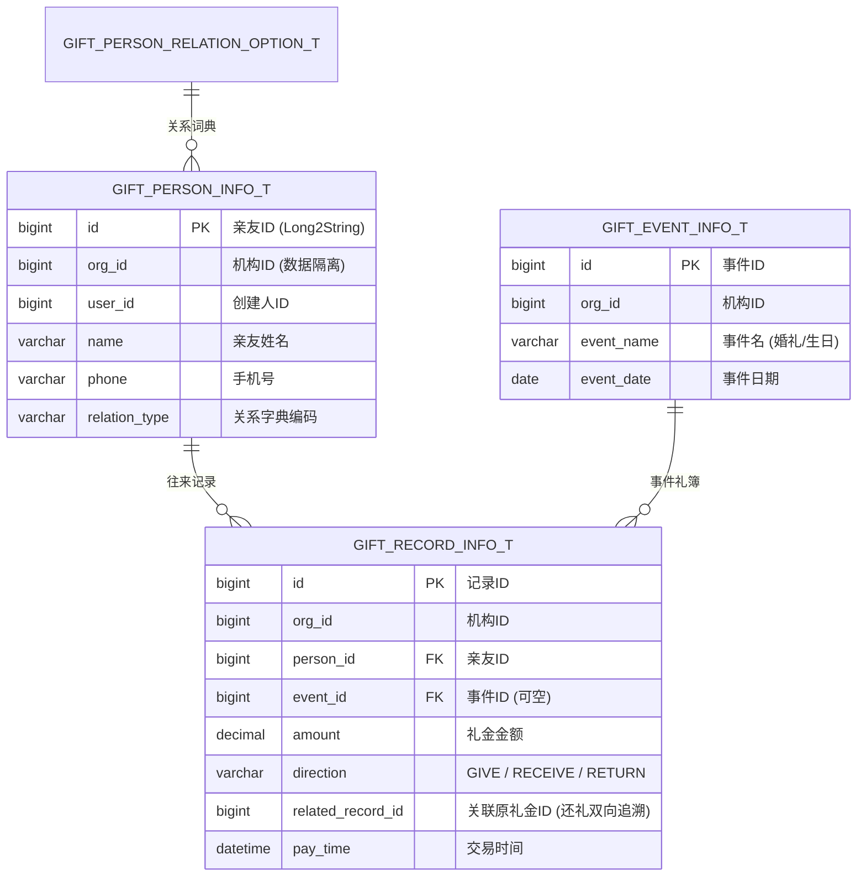

# 💻 TechSpec - 礼尚往来业务领域模型与契约

返回导航：[[Home]] | 功能描述：[[02-Features/01-Gift-礼尚往来/PRD-礼尚往来与人情记账功能说明|PRD-礼尚往来与人情记账功能说明]]

---

## 1. 架构领域划分与三表模型

礼尚往来微服务位于 `alex_miaosha_finance`，按 `record`、`person`、`event` 三大子域分包：



---

## 2. 核心技术设计

### 2.1 10w+ 级复合索引设计
```sql
ALTER TABLE gift_record_info_t ADD INDEX idx_org_user_paytime (org_id, user_id, pay_time);
ALTER TABLE gift_record_info_t ADD INDEX idx_org_person_direction (org_id, person_id, direction);
ALTER TABLE gift_record_info_t ADD INDEX idx_related_record_id (related_record_id);
```

### 2.2 数据权限与安全规约
- Mapper 查询必须显式标注 `@DataPermission(tableAlias = "t", userColumn = "user_id", orgColumn = "org_id")`；
- 严禁调用 MyBatis-Plus 默认的 `service.page()` 查询礼金数据（详见对应避坑 SOP）。

### 2.3 历史菜单彻底下线与全量收敛 (2026-09-19)
- **历史演进**：系统早期在「个人财务」(`selfFinance`) 下挂载了单表维度的「个人随礼信息」(`personalGift`, `/selfFinance/personalGift`)。随着「礼尚往来管理」(`gift`, `/finance/gift`) 完整领域模型（三表 + 数据概览 + 亲友 + 事由 + 礼金 + 统计）上线，老菜单已完全被新体系覆盖；
- **下线清理**：于 2026-09-19 对 `t_menu_info` (IDs: 1810856881968091138, 1810856882504962050) 及对应权限、角色关联彻底执行逻辑删除，清理 Redis 缓存并移除前端废弃组件目录 `alex_miaosha_front/src/views/finance/personalGift/`。

### 2.4 Picker 级动态新建与自动回填契约 (2026-09-24)
- **问题与场景**：在「快速记礼」等高频录入抽屉中，用户点击「+ 新建外部联系人」唤起 `gift-person-detail` 弹窗创建人员。
- **契约标准**：
  1. `gift-person-detail` 必须在保存成功时触发 `emit('success', resultPerson)` 传递新增的人员实体对象（含生成的 Long/String ID）；
  2. `gift-contact-picker` / `gift-person-picker` 监听 `success` 事件后，立即将该联系人注入本地 options 并将 `modelValue.value` 自动设为 `String(person.id)`；
  3. 自动触发父级（如抽屉）的 `watch` 获取画像统计，实现**零二次点击、即建即选**的无缝闭环体验。

### 2.5 AI 智能赋能与自然语言记账契约 (2026-09-29)
- **自然语言记账智能解析 (`POST ${api.version}/gift-record-info-t/ai-parse`)**：
  - 入参：`GiftRecordAiParseReq` (`content: String`, `defaultDirection: String`)；
  - 出参：`GiftRecordAiParseVo`（含 `personName`, `personId`, `isNewPerson`, `relationType`, `relationName`, `eventType`, `eventTypeName`, `amount`, `direction`, `payTime`, `location`, `remark`）；
  - 核心链路：调用 `ai_api` RPC（`AiAnalyzeApi#chat`，`bizType="gift-ledger-parse"`）提取结构化要素，并联动 `gift_person_info_t`、`gift_person_relation_option_t`、`gift_event_type_option_t` 自动匹配已有联系人及分类；若 AI 超时或不可用，无缝降级为本地正规正则与文化语义抽取保底。
- **智能礼金推荐理由与情景贺词 (`GET ${api.version}/gift-event-type-option-t/recommend-amount`)**：
  - 出参结构扩充：`GiftRecordRecommendAmountVo` 新增 `aiReasoning`（人情往来理由推理，结合往来历史对等性、吉利双数建议说明）与 `aiGreetingTip`（针对婚礼、乔迁、满月、寿宴等不同事由的得体贺词/祝福语）；
### 2.6 AI 端到端烟测与自动化验收基线 (2026-09-30)
- **移动端 AI 快速记账与贺词烟测 (`GIFT-AI-MOBILE-001`, `GIFT-AI-MOBILE-002`)**：
  - 测试用例定义于 `alex_miaosha_mobile/tests/midscene/gift/cases/mobile-ai-smoke.json`；
  - 运行命令：`pnpm test:ai:smoke`（执行 `scripts/playwright/run-mobile-ai-smoke.mjs`）；
  - 核心断言：
    1. 自然语言快速录入解析回填（金额 800、亲友 李四、事由 百日宴）；
    2. 智能推荐卡片与吉利贺词即时渲染（`data-testid="gift-record-ai-recommend-card"`）；
    3. 点击复制贺词触发剪贴板复制提示并激活触觉振动（`window.__hapticCallCount` 递增）；
  - 稳定性保障：基于 `installHapticProbe` 拦截 `navigator.vibrate`，配合网关 AES-128-CBC 统一加解密 Mock 与 `/api/am-` 路由隔离，支持 Chromium / Edge 多通道弹性降级启动。

### 2.7 移动端联系人详情页双模组件解耦 (2026-10-14)
- **背景痛点**：`giftPersonDetail/index.vue` 原为 1,140 行超大巨石单文件，混编了「Profile 档案画像展示」与「Edit/Add 资料表单」两套完全不同的视图及近 500 行样式；
- **架构重构**：
  1. `GiftPersonProfileView.vue`：独立承载 Hero 头像、脱敏手机号胶囊操作条、收送礼金统计卡片与往来历史明细；
  2. `GiftPersonEditForm.vue`：独立承载头像上传/清除、基础信息字段与校验、关系选项 Picker 联动弹窗及吸底保存；
  3. 主页面 `index.vue`：精简至 200 行以内的轻量控制器，专注于路由参数监听、双模切换与全局导航栏状态同步，全量单测与打包构建 0 报错。

### 2.9 PC 端 AI 快速记礼端到端验收与组件防御性重构 (2026-10-15)
- **PC 端 AI 快速记账烟测集成 (`AI-GIFT-PC-001`)**：
  - 测试用例定义于 `alex_miaosha_front/tests/midscene/rbac/cases/domain-ai-smoke.json`；
  - 运行命令：`pnpm test:ai:smoke`（执行 `scripts/playwright/run-domain-ai-smoke.mjs`）；
  - 覆盖场景：`#/finance/gift/record` 唤起快速记礼抽屉（`gift-record-open-drawer`）-> 输入自然语言快速记账内容（`gift-record-ai-input`）-> 点击智能解析（`gift-record-ai-btn`）-> 断言金额与事由自动回填（`gift-record-form-amount` 包含 800）；
  - 端口安全：规避默认 3000 端口本地冲突，统一弹性运行于 3100 端口。
- **组件入参防御性编程**：
  - `GiftRecordPartiesField.vue`、`GiftRecordAmountField.vue`、`GiftRecordEventField.vue` 统一使用 `withDefaults(defineProps<{...}>(), {...})` 并对数组属性添加 `(list?.length ?? 0) > 0` 保护；
  - `gift-org-member-picker` 与 `gift-person-picker` 的 `setOptions` 对入参统一执行 `(Array.isArray(list) ? list : []).forEach`，消除空对象或脏数据导致的 `forEach is not a function` 运行时白屏风险；
  - `useGiftRecordOptionsCache` 缓存加载器严格以 `Array.isArray()` 校验后端响应，确保前端缓存层健壮无污染。

### 2.10 后端领域模型七点法边界与数据权限加固 (2026-10-15)
- **金额上限与精度控制 (`GiftRecordInfoServiceImp`)**：
  - 金额七点法闭环：限制上限最大为 `9999999999.99`（DB `decimal(12,2)`），超过抛出业务异常友好拦截，消除 MySQL 500 级数据截断（Data Truncation）；
  - 小数精度规范化：针对 `scale > 2` 自动采用 `RoundingMode.HALF_UP` 截断四舍五入为两位小数。
- **实体基础字段防御与防呆 (`GiftPersonInfoServiceImp` / `GiftEventInfoServiceImp`)**：
  - `personName` 校验必填（1～50 字符，非空非纯空格），`phone` 校验长度 $\le 20$；
  - `eventName` 校验必填（1～100 字符，非空非纯空格）；
  - 事由主办人（`hostPersonId`）防越权绑定：若传入 `hostPersonId`，强制调用 `assertPersonAccessible` 校验其机构归属，杜绝跨机构冒领或数据渗透。
- **Analysis 聚合层空指针自愈 (`GiftAnalysisServiceImpl`)**：
  - `eventRanking` 与 `personRanking` 对分页返回记录集采用 `(page != null && page.getRecords() != null ? page.getRecords() : Collections.emptyList())` 守卫，杜绝空数据列表触发 NPE。
- **自动化集成测试护城河 (`*ServiceIT.java`)**：
  - `GiftRecordInfoServiceIT`（14 项用例）、`GiftPersonInfoServiceIT`（12 项用例）、`GiftEventInfoServiceIT`（11 项用例），覆盖参数越权、边界异常与 ORG_SHARED 数据隔离矩阵，全部 82 项用例 100% 绿灯。

### 2.6 SQL 唯一归口与零散文件清零规范 (2026-10-16)
- **严格单文件规约**：工程禁止在 `backend/alex_miaosha/doc/sql/` 下保留任何独立功能补丁脚本（如 `alex_finance_gift_management.sql` 已全量归口删除）；
- **模块数据库落点**：
  - 礼尚往来业务数据表（`gift_person_info_t`、`gift_event_info_t`、`gift_record_info_t`、`gift_person_relation_option_t`、`gift_event_type_option_t`、`gift_event_type_user_config_t`）全量收敛至 `backend/alex_miaosha/doc/sql/alex_finance.sql`；
  - 礼尚往来菜单、权限与角色（`gift:...`、`t_menu_info` 1900000000000001000 系列、`t_role_info` `gift_admin`/`gift_user`）全量收敛至 `backend/alex_miaosha/doc/sql/alex_user.sql`。

---

## 3. 关联方案与排错 SOP 导航
- 历史开发实施方案：
  - `02-Features/01-Gift-礼尚往来/历史开发方案/2026-05-14-gift-stitch-alignment.md`
  - `02-Features/01-Gift-礼尚往来/历史开发方案/2026-05-14-gift-stitch-alignment-design.md`
- 关联高危排错 SOP：
  - [[02-Features/01-Gift-礼尚往来/避坑与Bug修复SOP/避坑SOP-MyBatisPlus数据越权|避坑SOP-MyBatisPlus数据越权]]
  - [[02-Features/01-Gift-礼尚往来/避坑与Bug修复SOP/避坑SOP-亲友与事件查询入参契约断裂|避坑SOP-亲友与事件查询入参契约断裂]]
  - [[02-Features/01-Gift-礼尚往来/避坑与Bug修复SOP/避坑SOP-Vue组件Props数组防御与Playwright测试桩|避坑SOP-Vue组件Props数组防御与Playwright测试桩]]
  - [[02-Features/01-Gift-礼尚往来/避坑与Bug修复SOP/避坑SOP-端到端烟测弹窗遮罩拦截与移动端权限上下文断裂|避坑SOP-端到端烟测弹窗遮罩拦截与移动端权限上下文断裂]]


### 2.11 人情往来智能洞察报告与互赠收支平衡矩阵 (2026-10-20)

- **亲友互赠收支平衡矩阵 (GiftPersonBalanceVo)**：
  - 双向礼金差额对账：以亲友与关系圈层为维度，穿透核算 	otalReceiveAmount (TA送我)、	otalGiveAmount (我送TA) 与 
etBalance = Receive - Give；
  - 平衡状态机自动划分：SURPLUS（多收待回 / 礼金盈余）、DEFICIT（多送待收 / 礼金借出）、BALANCED（±200 元内基本持平）；
  - 人情失衡预警机制：净差额 ≥ 800 且超过 180 天未有往来互动时自动标定 isImbalancedAlert = true，提示适时体面回礼维护关系；
- **AI 智能回礼金额档位测算推荐器 (
ecommendReturnGift)**：
  - 算法规则引擎：综合历史互赠参考基准（取历史最高收礼金额或 500 保底）、事件类型加权（结婚 1.2、满月/寿宴 1.0、乔迁 0.95、白事 0.85）与亲疏关系加权（直系近亲 1.3、亲戚朋友 1.1、同事同学 1.0）；
  - 吉利档位阶梯映射：按民间传统吉利数字阶梯（200/500/600/666/800/888/1000/1200/1288/1688/1888/2000/2888/5000）向上归一化；
  - 输出三档金额建议（最低体面档、推荐平衡档、热络加码档），附带 AI 推导演算依据与定制祝颂语锦囊；
- **PC 端落地与交互**：
  - 在 src/views/finance/gift/analysis/index.vue 增加「亲友人情互赠平衡矩阵」面板，支持关系圈筛选与姓名搜索；
  - 点击操作列「AI 测算回礼」唤起 540px 独立抽屉 GiftReturnCalculatorDrawer.vue，支持一键切换事由测算、档位对比与一键复制贺词；
- **移动端落地与触觉赋能 (2026-10-20)**：
  - 在移动端 src/views/finance/gift/analysis/index.vue 新增平衡矩阵卡片列表，呈现亲友双向收支、差额胶囊及失衡预警条；
  - 封装移动端专用底部速算浮层 GiftReturnCalculatorPopup.vue，结合 Vant Popup 与手势流转；
  - 全流程融入触觉反馈：浮层调出（medium）、事由/城市圈切换（selection）、AI 测算成功（success）、失衡告警点击（warning）；
  - 数据护城河：引入 src/views/finance/gift/api/normalize.ts 纯函数，单测锁死 BigInt/Number 雪花 ID 字符串化契约；
- **互赠平衡矩阵 Excel 报表与对账单导出 (2026-10-20)**：
  - 导出接口：POST /gift-analysis/export-matrix 支持按关系圈层与亲友关键字动态过滤；
  - Excel 架构：采用原生 POI 生成双工作表（Sheet 1: 亲友互赠平衡矩阵，含收送双向金额、净差额与失衡预警；Sheet 2: 人情收支汇总总览）；
  - 编码与下载安全：响应头通过 ilename*=UTF-8'' 与 URL 编码规范输出带时间戳文件名，杜绝 Windows 中文乱码，前端解析 Content-Disposition 并可靠下载 Blob；
- **人情往来失衡与回礼备忘智能提醒 (2026-10-20)**：
  - XXL-Job 定时巡检联动：SysMessageRemindJob 每日自动扫描，针对净盈余 
etBalance >= 800 且距最近往来超 180 天的亲友，生成 BIZ_TYPE_GIFT_RETURN 站内信；
  - 幂等防扰设计：去重键 GIFT_RETURN:{personId}:IMBALANCE:{YYYY-MM} 按月防重复轰炸，并联动微信模板消息；
  - 双端无缝路由：PC 端与移动端消息卡片点击直达 #/finance/gift/analysis，一键开启 AI 回礼速算；
- **质量与契约防护**：
  - 测试清单：	ests/checklists/gift-analytics.md 与 	ests/checklists/message.md（含 M9 失衡备忘用例）；
  - 后端单测：GiftAnalysisExportTest.java + GiftAnalysisBalanceMatrixTest.java 100% 绿灯，全量 88 项 Gift 模块测试无缝全绿；
  - PC 前端单测：giftAnalytics.test.ts 7 项用例 100% 绿灯，ue-tsc --noEmit 0 报错；
  - 移动端单测：giftMobileBalanceMatrix.test.ts 7 项用例 100% 绿灯，移动端全量 23 个测试文件 129 项用例 100% 绿灯，构建打包 0 报错。

  - **端到端自动化烟测 (Midscene + Playwright)**：
    - PC 端用例 `GIFT-E2E-PC-BALANCE-MATRIX`：覆盖平衡矩阵渲染、失衡行标签匹配、AI 测算回礼抽屉 540px 调起、三档吉利金额（1600 推荐平衡档）展示、贺词复制、以及 `/gift-analysis/export-matrix` Excel 对账单文件流下载拦截；
    - 移动端用例 `GIFT-E2E-MOBILE-BALANCE-HAPTIC`：覆盖平衡矩阵卡片渲染、失衡预警徽标、唤起底部速算浮层、切换回礼事由、AI 测算及 `installHapticProbe` 拦截断言 `navigator.vibrate` 触觉震动计数递增。


### 2.12 礼尚往来人情收支可视化与亲友原位下钻对账 (2026-10-20)

- **PC 端 ECharts 6 双轴顺逆差图与圈层分布 (`alex_miaosha_front`)**：
  - 双轴走势图（收礼柱条 `#52c41a` + 随礼柱条 `#fa8c16` + 顺逆差折线 `#1890ff`）：计算公式 `netGap = receiveAmount - giveAmount`，支持月度与年度走势切换；
  - 动态按需加载：禁止全局静态 import，统一走 `loadEcharts()` 异步按需加载，采用 ECharts 6 `grid: { outerBoundsMode: 'same' }` 规范并在组件 `onUnmounted` 时解绑 `resize` 监听与 `chartInstance.dispose()`；
  - 圈层亲密度环形占比图：支持亲属、同事、好友、同学四大圈层比例切片，点击扇区触发 `matrixRelationFilter.value = params.data.rawType` 联动过滤下方平衡矩阵；
- **单亲友往来明细原位下钻抽屉 (`GiftPersonDetailDrawer.vue`)**：
  - 在平衡矩阵操作列增加「往来明细」入口，基于纯字符串 `personId` 原位滑出右侧明细抽屉；
  - 时间轴直观展现该亲友双向往来流水（收礼、随礼、回礼）、金额、交易时间及备注，并内置 AI 智能回礼测算快捷入口；
- **移动端轻量双轴走势与圈层胶囊过滤 (`alex_miaosha_mobile`)**：
  - 走势图采用轻量封装的 `BaseChart.vue`，实现紧凑小屏双轴柱折图；
  - 矩阵卡片上方新增横向滑动 `circle-chips-bar` 胶囊栏，点击调用 `triggerHaptic('selection')`（10ms 微振动）并触发 `filteredMatrixList` 多维条件过滤；
- **质量门禁与契约测试**：
  - 测试清单：`tests/checklists/gift-analytics-visualization.md`；
  - PC 端单测：`tests/unit/giftAnalyticsVisualization.test.ts`（4项专项断言，全量 84 项 Vitest + 21 项 Node 测试 100% 绿灯）；
  - 移动端单测：`tests/unit/giftMobileAnalyticsTrend.test.ts`（7项专项断言，全量 25 个测试文件 141 项测试 100% 绿灯）。


### 2.13 礼尚往来年度人情日历热力图与亲友社交力导向图谱 (2026-10-20)

- **PC 端年度人情日历热力图 (`GiftCalendarHeatmap.vue`)**：
  - 基于 ECharts 6 `calendar` 坐标系与 `heatmap` 系列，全量呈现全年 365 天收送礼金密集度与节庆办宴排期；
  - 动态色阶映射：收礼以翡翠绿（`#16a34a`）递进，随礼以暖橙（`#ea580c`）递进，净额以深天蓝（`#0284c7`）递进；
  - 交互下钻：悬停 Tooltip 展现当日收送金额与往来笔数，点击日期触发选定联动；
- **PC 端亲友社交人脉力导向图谱 (`GiftRelationshipGraph.vue`)**：
  - 基于 ECharts 6 `graph` 力导向布局（`layout: 'force'`），以本人核心节点（Category 0）辐射 5 大圈层 Hub（亲属、同事、好友、同学、其他）；
  - 节点半径按往来金额对数刻度缩放约束在 `[18, 40]` 像素，连线反映圈层归属；失衡亲友渲染红色预警边框，点击亲友直接唤起 `GiftPersonDetailDrawer`；
- **移动端人脉网络星阵适配 (`alex_miaosha_mobile`)**：
  - 报表走势卡片顶部提供「走势 / 人脉」切换药丸，点击触发 `selection` 触觉反馈并呈现前 8 位核心亲友人脉星阵；
- **质量门禁与契约测试**：
  - PC 端单测：`tests/unit/giftCalendarHeatmapAndGraph.test.ts`（4项用例，全量 88 项 Vitest + 21 项 Node 测试 100% 绿灯）；
  - 移动端单测：`tests/unit/giftMobileAnalyticsTrend.test.ts`（全量 25 个测试文件 143 项测试 100% 绿灯）。

### 2.14 全链路 E2E 验收与 Midscene 视觉探针矩阵 (2026-10-21)

- **PC 端真实端到端测试 (`GIFT-E2E-PC-VISUAL-PERSPECTIVES`)**：
  - 脚本与用例：`alex_miaosha_front/scripts/playwright/run-domain-ai-smoke.mjs`；
  - 覆盖场景：
    1. 礼尚往来大盘多视角切换导航栏 `[data-testid="analysis-perspective-nav"]`；
    2. 365天年度日历热力图挂载与色阶渲染 `[data-testid="gift-calendar-heatmap"]`；
    3. 亲友社交人脉力导向图谱挂载与圈层辐射 `[data-testid="gift-relationship-graph"]`；
    4. 穿透明细抽屉 `[data-testid="drawer-gift-person-detail"]` 原位展开与 AI 测算快捷按钮 `[data-testid="btn-drawer-ai-calc"]`；
  - 核心修复：补齐 `loadEcharts.ts` 中 `HeatmapChart`, `GraphChart`, `CalendarComponent`, `VisualMapComponent` 异步注册；修正 `index.vue` 模板中 `:balance-list="balanceMatrixRows"` 与 `GiftPersonDetailDrawer.vue` 的 `:open="open"` 规范；
- **移动端真实端到端测试 (`GIFT-E2E-MOBILE-GRAPH-HAPTIC`)**：
  - 脚本与用例：`alex_miaosha_mobile/scripts/playwright/run-mobile-ai-smoke.mjs`；
  - 覆盖场景：
    1. 移动端走势卡片与双轴图挂载 `[data-testid="gift-mobile-trend-card"]`；
    2. 走势/人脉切换药丸 `[data-testid="mobile-trend-tab-toggle"]` 点击；
    3. `installHapticProbe` 拦截并断言 `window.__giftVibrateCount` 物理微振动探针计数递增；
    4. 移动端人脉星阵图表 `[data-testid="gift-mobile-graph-chart"]` 挂载与平滑切回；
  - 核心修复：`BaseChart.vue` 中补齐 `GraphChart` 注册；
- **质量门禁与测试结果**：
  - PC 端 E2E：`GIFT-E2E-PC-BALANCE-MATRIX` + `GIFT-E2E-PC-VISUAL-PERSPECTIVES` 100% PASS；
  - 移动端 E2E：`GIFT-E2E-MOBILE-BALANCE-HAPTIC` + `GIFT-E2E-MOBILE-GRAPH-HAPTIC` 100% PASS；
  - PC 端全量 88 项 Vitest + 21 项 Node 测试 100% 绿灯；
  - 移动端全量 25 个测试文件 143 项单测 100% 绿灯。


### 2.15 礼尚往来圈层字典与菜单树接入多级缓存 (L1 Caffeine + L2 Redis) 与 Druid 连接池加固 (2026-10-21)

- **公共底座基础设施增强 (lex_miaosha_common/common_core)**：
  - **Druid 连接池防泄漏与安全加固**：
    - 提供 DruidPoolProperties，支持连接泄露检测自动回收开关 (
emoveAbandoned=true, 超时 
emoveAbandonedTimeoutMillis=300000)；
    - 慢 SQL 检测拦截 (StatFilter.slowSqlMillis=3000, 日志合并 mergeSql=true)；
    - SQL 注入防护防火墙 (WallFilter 严格模式)；
    - 针对连接池耗尽抛出 DataSourcePoolExhaustedException 并由增强器 DruidDataSourceEnhancer 动态应用。
  - **多级缓存架构 (MultiLevelCacheService)**：
    - L1 Caffeine 本地高速内存缓存 (initialCapacity=100, maximumSize=10000, 本地短过期默认 60s)；
    - L2 分布式 Redis 缓存 (全局统一 RedisTemplate，默认 TTL 1800s，自动叠加 0~10% 随机抖动防雪崩)；
    - 穿透防护：数据库不存在的空值写入特定哨兵对象 (SentinelNull，本地短 TTL 30s) 防穿透；
    - 热点 Key 探测 (HotKeyDetector)：滑动窗口访问计数，超频阈值动态预热并自动提升 L1 驻留生命周期。
- **微服务高频业务多级缓存落地**：
  - **礼尚往来亲友圈层字典 (inance_boot)**：
    - 业务入口：GiftPersonRelationOptionServiceImp.queryEffectiveOptionLabels()；
    - 缓存 Key：gift:relation:options:{ownerUserId}:{orgId}:{isSuper}；
    - 读流程：先读 L1 Caffeine -> 命中即返回；未命中读 L2 Redis -> 命中回填 L1；未命中查库并回填 L2 + L1；
    - 双写一致性：upsertLabel / upsertLabelIfAbsent 修改/新增字典标签时，通过 multiLevelCacheService.evict(key) 精准双层失效。
    - 验证：新增 GiftPersonRelationOptionCacheTest.java 覆盖 L1 命中、穿透哨兵、双层失效与回填；90 项单测 100% 绿灯。
  - **RBAC 全量共享菜单树 (user_boot)**：
    - 业务入口：MenuInfoServiceImp.getTree() 针对 isFullQuery（超级管理员无过滤条件全量树）；
    - 缓存 Key：LoginKey.LOGIN_MENU_ALL_TREE_KEY (LoginKey:login:in:menu_all_tree)；
    - 保持数据权限隔离：机构用户与普通用户的 scoped 菜单查询严格走带 @DataPermission 的 mapper 并内存组装，禁止读写全量缓存；
    - 双写一致性：新增/更新/删除菜单 (ddMenuInfo, updateMenuInfo, deleteMenuInfo) 触发 clearMenuCache，精准 evict 全量菜单多级缓存；
    - 验证：新增 MenuMultiLevelCacheIT.java 覆盖超管多级缓存命中与更新后缓存双层失效；35 项单测 100% 绿灯。
- **质量清单同步**：
  - 更新 	ests/checklists/druid-pool-leak-security.md；
  - 更新 	ests/checklists/cache-multilevel-hotkey-security.md。

## 十一、礼金业务核心契约与自动化测试防线（2026-10-22 落地）

### 11.1 核心业务契约防线（GiftRecordBusinessRuleTest）
- **方向与关联守则**：
  - `GIVE`（送礼）/ `RECEIVE`（收礼）强制大写枚举校验，非法值或小写严格抛出 400 `FinanceException`。
  - `isReturn=1`（还礼）必须携带 `relatedRecordId`，且关联记录必须存在、归属于当前用户与当前机构、原始方向必须为 `RECEIVE`，且禁止关联自身记录（H7 漏洞防御）。
  - `RECEIVE` 记录入库时 `returnedFlag` 默认初始化为 `0`（未还）。
- **金额七点法（Boundary Value）边界控制**：
  - 负数金额、零金额拦截；
  - 超过两位小数（如 99.999）进入系统自动舍入截断为两位小数（99.99），防止浮点与精度漂移。
- **越权防护（Ownership 防御）**：
  - 修改（`updateGiftRecordInfo`）/ 删除（`deleteGiftRecordInfo`）/ 标记已还（`markReturned`）前校验归属，跨用户或跨机构操作统一拦截抛出 403 `FinanceException`。
  - 更新时前端传入的 `orgId` 与 `userId` 强制使用数据库记录原有值锁定，杜绝篡改归属所有者。
  - 批量删除 CSV 解析（`parseIds`）健壮捕获非法格式字符，转为友好业务异常（H12）。
- **回礼幂等与待还计算**：
  - `markReturned` 重复调用具备幂等性（已有记录已还状态下再次标记直接安全返回，不重复写盘与递增）。
  - `calculatePendingReturnAmount` 计算待还金额：收礼金额减去所有指向该收礼的有效还礼金额总和；超出还礼时待还金额自动兜底为 `0.00`。
  - `getSummary` 收支平衡统计：净额严格按 `inAmount - outAmount` 精确计算，并妥善处理 null 金额与空记录兜底。

### 11.2 亲友档案隔离与画像聚合（GiftPersonInfoServiceIT）
- `getProfile` 亲友画像详情强制校验亲友所属 `orgId` 与 `userId`，跨机构或跨用户越权直接 403 拦截（H5 漏洞防御）。
- 亲友礼金往来记录聚合时，仅统计当前登录用户对该亲友的往来记录，严禁跨租户/跨用户串数据。

### 11.3 测试执行战报
- `GiftRecordBusinessRuleTest`：31 项单测用例 100% 绿灯。
- `GiftPersonInfoServiceIT`：11 项集成用例 100% 绿灯。
- `alex_miaosha_finance` 礼尚往来全套测试用例：118 项用例 100% 绿灯。
- 测试清单 `tests/checklists/gift.md` 章节 5.1.1 与 5.1.2 状态同步更新为 `[x]` 完成。

### 2.16 核心业务接口与大模型流式调用分布式滑动时间窗口限流加固 (@RateLimiter) (2026-10-22)

- **核心治理目标与策略矩阵**：
  - **用户身份认证安全 (user_boot)**：
    - POST /api/v1/user/t-user-info/login 接入 @RateLimiter(limitType = LimitType.IP, count = 5, time = 60)，彻底抵御同一客户端 IP 的高频撞库穷举与暴力破解攻击；
  - **AI 智能大模型防刷与算力保护 (inance_boot)**：
    - POST /api/v1/finance/finance-info/ai-parse（日常记账多场景文本抽取）：@RateLimiter(limitType = LimitType.USER, count = 10, time = 60)；
    - POST /api/v1/finance/finance-info/ai-parse-stream（SSE 流式记账打字机长连接）：@RateLimiter(limitType = LimitType.USER, count = 6, time = 60)；
    - POST /api/v1/finance/finance-budget-info/ai/recommend（AI 预算智能测算）：@RateLimiter(limitType = LimitType.USER, count = 5, time = 60)；
    - POST /api/v1/finance/finance-budget-info/ai/parse（AI 自然语言预算指令解析）：@RateLimiter(limitType = LimitType.USER, count = 10, time = 60)；
    - POST /api/v1/finance/cpn-coupon-info/ai-plan（优惠券 AI 智能策划方案生成）：@RateLimiter(limitType = LimitType.USER, count = 5, time = 60)；
  - **大数据量导出防 JVM OOM 攻击 (inance_boot)**：
    - POST /api/v1/gift-record-info-t/export-matrix（亲友互赠收支平衡矩阵 Excel 导出）：@RateLimiter(limitType = LimitType.USER, count = 3, time = 60)；
    - POST /api/v1/gift-record-info-t/export（礼金记录全量明细 Excel 导出）：@RateLimiter(limitType = LimitType.USER, count = 3, time = 60)；
- **异常拦截与协议规范**：
  - 超限请求抛出 RateLimitException，经由 GlobalExceptionHandler 统一映射标准 HTTP 状态码 429 Too Many Requests，并在 Response Header 中注入 Retry-After: {seconds}，前端友好提示防误触；
- **自动化测试保障**：
  - UserLoginRateLimiterTest.java（覆盖 IP 限流契约与超频 429 拦截，2项测试全绿）；
  - ControllerRateLimiterIT.java（覆盖 Excel 导出拦截、AI 记账注解契约，3项测试全绿）；
  - 全量 70+ 礼尚往来业务单测 100% 绿灯。
### 2.17 办宴人情礼簿高保真纸质打印预览与对账台账导出 (@media print) (2026-10-22)

- **前端高保真打印实现 (lex_miaosha_front)**：
  - 在 iews/finance/gift/event/index.vue 操作列挂载「礼簿打印」操作按钮；
  - 核心组件：GiftRegistryPrintModal.vue（纸质礼簿台账高保真打印预览 Modal）；
  - 算法与工具支持：
egistryPrint.ts（包含 	oChineseCurrency 中文大写人民币算法、ormatRegistryMoney、isLargeAmountRegistry 与 calculateRegistryMetrics 汇总）；
  - 打印体验：支持传统宣纸朱红风与现代省墨公文风切换，@media print 原生穿透与表格 page-break-inside: avoid 防断裂；
- **自动化测试保障**：
  - 前端单测：	ests/unit/giftRegistryPrintModal.test.ts（8项测试 100% 绿灯通过）；
  - 全量回归：PC 端 20 个测试套件、96 项单测 + 21 项 Node 测试全部 100% 绿灯。

### 11.4 事由与集成权限矩阵加固（5.1.3 & 5.2 落地）
- **事由待办时区安全（GiftEventInfoServiceIT）**：
  - `monthPendingCount` 采用 `DateUtils.now()` 获取带时区时间的年份与月份，杜绝系统默认无时区漂移漏洞（H17）。
  - `getSummary` 实现事由待办、礼金总额、活跃亲友（distinct 去重）多维度聚合与空安全防御。
- **Controller 层安全与异常映射（GiftRecordControllerIT）**：
  - 覆盖 GET 单查、PUT 修改、DELETE 批量删除跨租户/跨机构越权访问，确保由 `GlobalExceptionHandler` 统一映射为标准 HTTP 500 与业务错误码 403。
  - 覆盖合法请求的 200 响应与参数校验。
- **权限矩阵全覆盖（GiftPermissionIT - 4 身份 × 5 操作 = 20 Case）**：
  - **4 身份**：超管（`super_super`）、机构管理员（`admin`）、普通用户本人（`user`）、跨机构用户（`other`）；
  - **5 操作**：单条查询、新增还礼（关联收礼记录）、修改记录、删除记录、标记已还；
  - **测试断言**：超管直通任意资源；机构管理员受限本机构；普通用户受限本人；跨机构用户一律强行阻断 403。
- **质量总战报**：
  - `GiftEventInfoServiceIT`：15 项用例 100% 绿灯。
  - `GiftRecordControllerIT`：12 项用例 100% 绿灯。
  - `GiftPermissionIT`：20 项用例 100% 绿灯。
  - 礼尚往来微服务全量测试用例：**170 项用例 100% 全绿通过**！
  - 测试清单 `tests/checklists/gift.md` 章节 5.1.3、5.2.1、5.2.2 状态同步更新。
