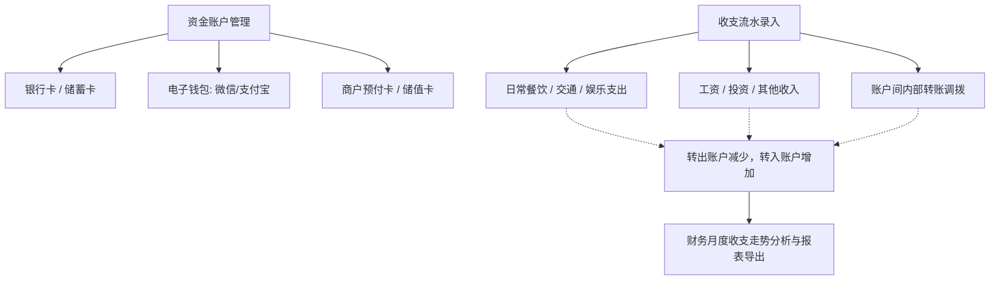

# 📋 PRD - 个人资产与收支记账功能说明

返回首页：[[Home|知识库首页]] | 架构总览：[[00-System/全栈系统架构总览与交互流|系统架构总览]]

---

## 1. 业务全景与功能定位

个人资产与收支记账模块（SelfFinance）为用户提供多账户资金全景监控、日常收支记账流水追踪及多维财务健康分析。

---

## 2. 页面与功能需求清单

### 2.1 账单流水与日常记账 (`/selfFinance/financeManager`，原财务信息菜单升级)
- **轻量收支小结条**：展示当月/选定周期总支出（-¥xxx）、总收入（+¥xxx）、当期结余（±¥xxx）及有效统计账单笔数；
  - **转账数据剔除规约**：默认收支统计与笔数自动剔除「转账」（`type_code = '转账'`）内部往来流水，避免资金在银行卡、微信、支付宝间调配虚增收支总额与结余；
  - **交互透传**：概览条明确展示「不含转账」提示挂件与气泡说明；仅当用户在高级筛选中显式输入或选择「转账」类别时，统计才针对转账专项汇总；
- **单行紧凑筛选工具栏 (Tailwind Soft UI Filter)**：
  - 收支类型快捷切换：升级为 Tailwind 浅灰底 Segmented 分段器（`[全部 / 支出 / 收入]` 滑块切换，激活态为白底微投影与 Indigo 靛蓝主色 `text-indigo-600`）；
  - 业务时间快捷预设：支持【本月】、【上月】、【近30天】、【全部】无框 Pill 胶囊快速切换；
  - 关键词即输即搜，并支持展开低频高级条件（类别、支付方式、归属成员）；
- **高密度双行复合明细流水 (Taste-Skill `VISUAL_DENSITY=8` & Tailwind Soft UI)**：
  - 【＋ 记一笔】（`bg-indigo-500 shadow-indigo-500/25`）与【智能记账】（`bg-indigo-500/10 text-indigo-600`）主按钮快速唤起录入与解析；
  - **双行复合主列**：首行展示加粗账目名称（带单行溢出省略保护）与状态呼吸圆点（有效绿点 `bg-emerald-500` 带双环光晕 / 失效灰点），副行展示经办成员无框微徽章与等宽格式化时间；
  - **弹性主列 + 比例中间列防断层布局**：第一列（`账目与归属`）设置 `minWidth: 240` 且不写死百分比以自适应吸收视口弹性空间；中间三列按比例均衡分配（「类别」`width: '20%', align: 'center'`、「支付方式」`width: '20%', align: 'center'`、「金额」`width: '16%', align: 'right'`），「操作」列刚性固定 `width: 190, fixed: 'right'`，彻底消除宽屏下第一列独占空白导致的视觉断层，并防止 AntD `<colgroup>` 百分比与固定像素混排算术溢出；
  - **全页红绿语义色与 Slate 灰阶统一**：概览卡与表格全面统一为 Tailwind `emerald-600`（收入）与 `rose-600`（支出），中性文字统一为 `slate-900 / 600 / 500 / 400`，彻底剔除旧版 AntD 荧光红绿与暖灰混用；
  - **无框 10% 透明底柔光胶囊**：类别胶囊、支付渠道胶囊与统计微标签统一采用 `rounded-full` + 10% 透明度纯色底（`border-0`），摒弃传统 `1px solid` 实线边框，卡片统一采用 `rounded-2xl border-0 shadow-sm shadow-slate-200/60`；
  - **操作列磁吸微交互**：查看、编辑、删除按钮挂载 `.table-action-btn`，Hover 呈现语义轻色底（Slate / Indigo / Rose）并触发 GPU 平滑微放大（`scale-[1.08]`）；
- **响应式双子 SaaS 概览面板 (.finance-overview-grid)**：
  - 将「全量账单统计」与「零花钱月度预算」由原单条生硬卡片拆分为左右独立的现代 SaaS 指标网格卡（`.finance-overview-grid`，支持大中小屏幕自适应折行）；
  - 左侧展示账目收支总览（总支出、总收入、净结余、笔数），右侧展示本月预算核心状态（剩余可用/超支、上限与已用微指标、进度条、计入分类、调整预算入口）；
  - 核心金额指标升级为 18px 等宽粗体，配合轻底微图标，兼顾通透度与高信息密度。

- **零花钱预算弹窗 (Tailwind 风格与动态类别提取)**：
  - 弹窗采用 Tailwind 现代卡片化排版，摒弃传统旧式表单，提供视觉通透的胶囊 Chip 交互；
  - 取消写死的静态预设分类，后端提供接口 GET /finance-budget/categories?yearMonth={YYYY-MM} 动态提取「上个月 + 本月」真实记账的非空有效 type_code（排除转账）；
  - 选项集合包含「收支大类（支出、收入）」与「动态提取账目类别」，支持一键全选与清空。

### 2.2 收支与转账流水 (`/selfFinance/accountRecordInfo`，原猫超管理/账户流水)
- **三类流水录入**：
  - **支出**：选择付款账户、分类标签、支出金额、发生时间、备注；
  - **收入**：选择收款账户、收入分类、收入金额、发生时间；
  - **转账**：选择转出账户、转入账户、调拨金额、手续费。
- **流水检索**：支持按时间区间、所属账户、分类标签、收支类型进行多维组合筛选。

### 2.3 个人财务驾驶舱 (`/selfFinance/financeAnalysis`，兼容原 `/finance/financeAnalysis`)
- **6 模块信息架构（左 `7/12` 流量消费分析 · 右 `5/12` 存量资产与流水）**：
  - **00 · 顶部单行检索栏**：左侧统计月份与 `[上月 | 本月]` Segmented 胶囊组、归属成员切换（「家庭组所有人」与组织内各成员），右侧「个人财务驾驶舱」定位徽章与刷新分析按钮。
  - **01 · 当月核心财务指标（左 `7/12`，第一视觉主焦点）**：采用「1 主 + 2 辅」非对称布局，左侧 `text-3xl` 突出 **本月净结余**（收入 - 支出）与 **当月储蓄率** 胶囊；右侧上下并列 **本月总收入**（Emerald）与 **本月总消费**（Rose）及小号同环比辅助徽章。
  - **02 · 资产净值概览（右 `5/12`，存量资产总盘）**：顶部 `text-3xl` Indigo 突出 **总资产净值** 与同环比；下方 3 列子卡严格对齐资产恒等式 `总资产净值 = 流动资金 + 信用负债 + 水电话费专户预存`。
  - **03 · 当月收入与支出结构（左 `7/12`，横向进度条排行）**：告别传统双大环形图，升级为 **支出结构 TOP 5 + 其他** 与 **收入结构 TOP 5 + 其他** 横向进度条榜单，同步展示 `getCategoryEmoji` 图标、分类名、笔数、金额与占比，点击任意分类一键穿透至账单流水页对应分类。
  - **04 · 账户资产分布（右 `5/12`，Segmented 分类明细）**：通过 `[流动资金 | 信用负债 | 专户预存]` Segmented 胶囊切换账户分组，展示专属品牌 SVG 图标、账户余额与组内占比进度条，支持点击穿透对应支付渠道流水。
  - **05 · 收支变化趋势（左 `7/12`，平滑双折线面积图）**：头部提供 `[月度趋势 | 当月日趋势]` Segmented 切换，ECharts 采用 Emerald 收入与 Rose 支出平滑双折线 + 渐变面积图，悬浮 Tooltip 同步计算展示净结余。
  - **06 · 最近财务流水（右 `5/12`，近期变动速览）**：联动拉取当前筛选月份与成员下最新 6 条账单流水（日期、分类 Emoji、账目名称、支付渠道、收支变色金额），支持单条点击与「全部流水 →」一键跳转 `/selfFinance/financeManager`。
- **归属成员与家庭组全景查询**：顶栏支持切换「家庭组所有人」与组织内各成员。选择「家庭组所有人」时，后端自动剔除 `belong_to` 过滤条件，聚合全家庭/组织成员的资产净值、收支明细与各月走势；前端统一保持 ID 字符串交互，杜绝 64 位 Long 精度截断。

### 2.4 历史单表随礼菜单下线说明 (`/selfFinance/personalGift`)
- **下线背景**：早期在个人财务模块下挂载的「个人随礼信息」(`personalGift`) 仅支持单表流水登记，缺乏社交维度的亲友档案、往来双向对账、事件礼簿管理及深度统计看板。
- **业务收敛**：随着系统顶层独立一级模块 **「礼尚往来管理」** (`/finance/gift`) 的全面上线，该旧单表菜单与前端页面已于 2026-09-19 彻底下线清理，实现记账与人情领域的清晰边界划分。

### 2.5 家庭管理员全景总账与人情看板融合规范 (Ponytail Model)
- **家庭全景双轨收支模型**：
  - 当登录用户拥有「家庭管理员」角色或处于家庭上下文时，首页工作台（`OrgAdminDashboard`）融合个人日常收支与礼金往来：
    - **本月综合总支出**：`日常月支出 + 随礼支出`，采用现代 SaaS 顶栏分离排版架构，副胶囊拆解：`日常 ¥X · 随礼 ¥Y`，附环比微徽章（悬浮 Tooltip 展开同比）；
    - **本月综合总收入**：`日常月收入 + 收礼收入`，副胶囊拆解：`日常 ¥X · 收礼 ¥Y`，附环比微徽章（悬浮 Tooltip 展开同比）；
    - **本月家庭净结余**：`综合总收入 - 综合总支出`，剔除 `¥ +` 语法错误，支持盈亏动态预警与储蓄率微胶囊标识（`储蓄率 95% · 结余充裕`），附资产结余环比/同比微徽章；
    - **家庭在册亲友**：在册成员数，副标签按照**发生日期（`event_time` / `pay_time` / `info_date`）**统一度量：展示本月发生人情事由场数及本月记账笔数（如 `本月人情 0 场 · 记账 24 笔`），避免与全历史数据混淆；
    - **交互穿透直达**：4 大指标卡均支持鼠标指针手势与微动效，点击一键穿透直达日常记账明细、财务分析大盘及亲友名录。
- **多维走势与分类构成交互**：
  - 支持 `[综合走势 | 支出分类 | 人情专线]` 三段式一键无感切换，自适应动态渲染月度综合收支柱状/折线复合图、当月日常分类环形饼图与礼金收支专线。
- **家庭最新人情事由卡片 (替代零散待还礼)**：
  - 彻底摒弃单人零散随礼堆砌，统一升级为展示家庭最新举办/近期的 5 场重大事由（婚礼、满月、寿宴等），呈现事由类型彩色微标签、办事人、举办时间、亲友参与规模与礼金吞吐，并提供「查看礼簿」一键直达通道。
- **家庭专属高频快捷入口**：
  - 精准替换 B 端商品与秒杀入口为家庭 5 大核心通道：记一笔日常账、随礼/收礼登记、人情事由大盘、家庭财务分析、家庭成员档案。

### 2.6 零花钱月度预算与分类消费管控 (2026-10-08 / 2026-10-09 体验升级)
- **月度零花钱预算设定**：
  - 用户可在日常记账（`financeManage`）及移动端顶部查看本月零花钱预算总额、已用消费、剩余额度/超支金额及使用率进度条；
  - **Task-Skill 交互优化 (2026-10-09)**：
    - **快捷面额填充**：提供 `¥1000`、`¥2000`、`¥3000`、`¥5000` 快捷胶囊，一键填入；
    - **范畴显式分流**：支持「全量消费 (推荐，默认纳入全部非转账生活支出)」与「指定专属分类 (圈选餐饮美食、日用等)」单选切换，杜绝三态歧义；
    - **双轨分类调色盘**：系统预设 10 项常用高频生活分类 + 近两月真实流水双轨合并，彻底消除冷启动无账单时的白板问题；
    - **实时试算卡片**：弹窗内即时预演本月已匹配消费、调整后剩余额度、使用率进度条与健康/临界/超支状态，彻底告别盲盒式保存；
- **智能历史继承（0-Cron Job Ponytail模式）**：
  - 首月配置后，次月及未来月份默认自动继承上一配置月的预算额度与分类设置（显示“继承自上月”）；
  - 任一月份均可按需独立修改，系统仅为当前月份写入独立快照，决不污染历史数据，也无需每月运行后台跑批定时任务。

### 2.7 PC 端账单流水列表与记账抽屉 Tailwind Soft UI 视觉与交互升级 (2026-11-03)
- **设计系统对齐 (`ftc-web` Tailwind Soft UI 规范)**：
  - 全域采用 **Indigo 主色 (`#4F6AF6` / `indigo-500`)**、**Emerald 收入色 (`emerald-600`)**、**Rose 支出色 (`rose-600`)** 与 **Slate 中性灰阶 (`slate-900/600/500/400`)**，告别早期高饱和荧光色（`#ff4d4f` / `#52c41a`）；
  - 容器统一为 `rounded-2xl` 柔和圆角与微阴影 (`shadow-[0_2px_10px_rgba(15,23,42,0.03)]`)，分类与状态胶囊统一采用 **10% 透明度无边框 Soft Pill (`border: none, rounded-full`)**。
- **5 列黄金比例流水表格（消除宽屏中部留白断层）**：
  - 保持 5 列精简结构，首列 `账目与归属` 采用两行复合主列（第 1 行：收支圆点 + 账目名称 + 冲销标签；第 2 行：归属成员微胶囊 + 精确到秒业务时间），并设为弹性自适应宽度 (`minWidth: 240`)，配合中部比例列 (`类别 20%`、`支付方式 20%`、`金额 16%`) 与右侧刚性操作列 (`width: 230, minWidth: 220`)，彻底消除 1080p/2K 宽屏下的中部空白断层；
  - `config/index.ts` 统一收敛 `categoryEmojiMap`（扩充覆盖 `转账 💸`、`公司 🏢`、`出行 🚗`、`剪发 💈`、`取暖 🔥`、`生活缴费 🧾`、`年金 🏦`、`杂物 📦` 等高频分类）、`getCategoryEmoji` 与无边框 `getCategoryPillStyle`。
- **记账/修改/详情抽屉 (`finance-manager-detail`) 升级**：
  - **三段式呼吸卡片分组**：按认知流拆分为「核心账目与金额」、「分类标签与快捷池」、「账户、归属与时间」3 张 `bg-slate-50/80 rounded-2xl p-4` 卡片，并在 `detailLoading` 期间提供骨架屏过渡及 `isEdit` 稳定态守卫；
  - **零下拉 Segmented 胶囊切换**：「收支类型（支出/收入）」与「有效状态（有效/无效）」升级为一键点击的 Tailwind Segmented Control，点击时联动 Rose/Emerald 语义色并自动触发 `validateFields` 校验；
  - **全彩 Emoji 快捷分类池与支付品牌图标**：热门分类胶囊与列表页共享 `getCategoryEmoji`，选中态呈现 `bg-indigo-500 text-white shadow-sm` 柔和呼吸反馈；「支付方式」下拉选项与选中回显统一挂载专属品牌 SVG 图标（现金、银行卡、微信、支付宝、花呗、京东、白条、电费/话费衍生渠道等）与 `<CreditCardOutlined />` 兜底图标；
  - **零花钱预算设置抽屉 (`finance-budget-modal`)**：由原本易超屏的居中 `<a-modal>` 升级为右侧常驻抽屉 [`BaseRbacDrawer`](file:///f:/workplace/project/myself/frontend/alex_miaosha_front/src/components/rbac/BaseRbacDrawer.vue)（`width="600px"`），对标记账抽屉实现无框 AI 智能助手横幅、金融级金额输入框与紧凑快捷填充胶囊、双列对称 Segmented「收支方向 + 统计范畴」切换、全彩 Emoji 分类池（实时合并已选分类确保 `已选 X 项` 0 延迟一致）及 0 毫秒初始试算回显。
- **个人财务驾驶舱 (`financeAnalysis`) 6 模块重构**：
  - **顶栏与周期胶囊 (`00`)**：升级为 `rounded-2xl` Soft UI 单行检索工具栏，「上月 / 本月」采用 `searchDateTime` 动态高亮的 Segmented 胶囊组，右侧展示「个人财务驾驶舱」定位徽章与刷新按钮；
  - **核心流量指标与存量资产分离 (`01` + `02`)**：首屏采用 `7:5` 黄金比例非对称双卡——左卡 `01 · 当月核心财务指标` 以 `text-3xl` 聚焦「本月净结余 + 储蓄率」，右侧辅以本月总收入（Emerald）与本月总消费（Rose）；右卡 `02 · 资产净值概览` 以 Indigo 聚焦「总资产净值」，下方三列拆解 `流动资金 + 信用负债 + 水电话费预存`，严密闭环资产恒等式；
  - **横向结构排行与 Segmented 账户分布 (`03` + `04`)**：中屏左卡 `03 · 当月收入与支出结构` 将原双大环形图升级为「支出 TOP 5 + 其他」与「收入 TOP 5 + 其他」横向进度条排行榜（挂载 `getCategoryEmoji` 并支持点击穿透流水）；右卡 `04 · 账户资产分布` 采用 `[流动资金 | 信用负债 | 专户预存]` Segmented 胶囊切换并挂载品牌 SVG 图标与占比条；
  - **平滑双折线趋势与最近财务流水 (`05` + `06`)**：底屏左卡 `05 · 收支变化趋势` 支持 `[月度趋势 | 当月日趋势]` Segmented 切换与 Emerald/Rose 平滑双折线面积图（悬浮展示净结余）；右卡 `06 · 最近财务流水` 实时拉取当前月份与成员下最新 6 笔流水并支持一键跳转账单流水页。

---

## 3. 验收标准 (Acceptance Criteria)

- **[AC1] 账户流水事务原子性**：录入转账流水时，转出账户扣减与转入账户增加必须包裹在同一本地事务中，禁止出现单边账。
- **[AC2] 用户数据安全隔离**：用户仅能查看、操作归属自身用户 ID 的账户资产与交易流水，严格受 `@DataPermission` 数据权限约束。
- **[AC3] 统计数值与流水汇总一致性**：收支分析图表展示的月度支出/收入汇总金额，必须与筛选该月份流水记录计算出的总和 100% 吻合。
- **[AC4] 转账流水不虚增日常收支**：日常记账概览条在未显式筛选转账时，必须自动剔除 `type_code = '转账'` 的所有记录，确保总支出、总收入、净结余真实反映日常消费能力。
- **[AC5] 零花钱预算回溯与超支预警**：当月无独立设置时自动继承历史最近月配置；当累计消费超过预算上限时，进度条与数字显示显式超支告警。
- **[AC6] 移动端独立预算管理二级动态路由**：移动端预算调整改造为独立二级动态路由 `/finance/financeManager/budgetManage`（`hide_in_menu: '1'`），支持原生返回与全屏沉浸试算；列表大盘卡片通过 `onActivated` 实现返回即时刷新。
- **[AC7] 细粒度权限与家庭成员属主保护**：家庭成员与管理员均拥有流水查询与预算大盘查看权限（`budget:view`）；家庭成员仅可编辑/删除属于个人创建的流水（`belongTo === loginUserId`），他人流水禁止篡改；家庭成员在预算页面处于只读试算模式；家庭管理员与超管拥有组内全员流水管理与预算编辑调整权限（`budget:edit`）。

