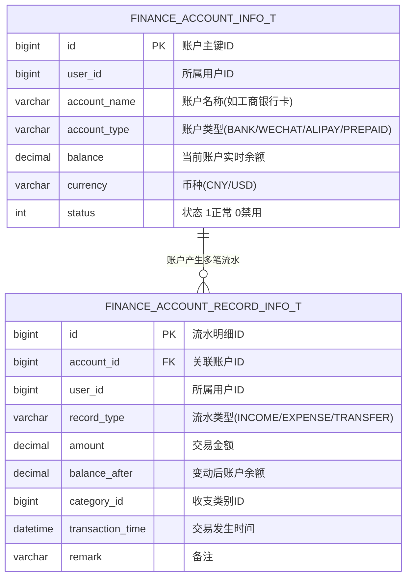

# 🛠️ TechSpec - 收支核算与预付卡流水设计

返回功能说明：[[02-Features/05-SelfFinance-个人资产财务/PRD-个人资产与收支记账功能说明|PRD-个人资产与收支记账功能说明]]

---

## 1. 实体领域模型与核心表



---

## 2. 核心技术规格

### 2.1 账户转账与事务防并发处理

```java
@Transactional(rollbackFor = Exception.class)
public boolean transfer(TransferVo req, Long userId) {
    // 1. 悲观锁锁定源账户与目标账户，按账户ID从小到大锁定避免死锁
    Long firstId = Math.min(req.getFromAccountId(), req.getToAccountId());
    Long secondId = Math.max(req.getFromAccountId(), req.getToAccountId());
    
    financeAccountMapper.selectByIdForUpdate(firstId);
    financeAccountMapper.selectByIdForUpdate(secondId);
    
    // 2. 检查余额充足
    FinanceAccountInfo from = financeAccountMapper.selectById(req.getFromAccountId());
    if (from.getBalance().compareTo(req.getAmount()) < 0) {
        throw new BusinessException("账户余额不足");
    }
    
    // 3. 执行双边流水扣减与增加
    financeAccountMapper.updateBalance(req.getFromAccountId(), req.getAmount().negate());
    financeAccountMapper.updateBalance(req.getToAccountId(), req.getAmount());
    
    // 4. 插入两笔对称流水日志
    insertRecord(from, req.getAmount().negate(), "TRANSFER_OUT");
    insertRecord(to, req.getAmount(), "TRANSFER_IN");
    return true;
}
```

### 2.2 数据权限与多租户

所有个人财务与流水操作必须在 Service 层面强制传入 `userId = SecurityUtils.getLoginUserId()` 进行硬编码约束或使用 `@DataPermission(tableAlias = "f", userField = "user_id")` 进行 SQL 级行过滤，防止越权操作他人物料。

### 2.3 财务收支多维分析双柱核算架构

- **聚合计算规范**：日/月度收支走势分析中，收入（`income_amount`）与支出（`expense_amount`）独立通过 `CASE income_and_expenses WHEN 'income'/'expense' THEN amount ELSE 0 END` 聚合求和，解耦正负抵消。
- **前后端契约**：`AnalysisVo` 提供独立字段 `BigDecimal incomeAmount` 与 `BigDecimal expenseAmount`，保留 `amount` 保证历史向下兼容。
- **前端可视化呈现**：`barChart.vue` 提供双柱分组对比（收入绿色 `#10b981`、支出暖橙 `#f97316`），全面反映同一时间粒度下的资金流入与流出真实全貌。

### 2.4 历史单表随礼菜单下线与清理规范 (2026-09-19)

- **数据库级联清理**：
  - `t_menu_info`：逻辑删除主菜单（`id = 1810856881968091138`，`name: personalGift`，`path: /selfFinance/personalGift`）与详情菜单（`id = 1810856882504962050`，`name: personalGiftDetail`），置 `is_delete = 1`；
  - `t_permission_info`：逻辑删除权限项 `selfFinance:personalGift`（`id = 1810856883473846273`）；
  - `t_role_permission_info`：逻辑删除对应角色绑定记录（IDs: `28`, `29`）。
- **Redis 缓存失效与预热**：
  - 级联清除 `LoginKey:login:in:menu_all_tree` 全量共享菜单树；
  - 遍历清除各在线用户的 `LoginKey:login:in:permission_context:*` 权限上下文，保证用户刷新页面即刻生效。
- **前端废弃视图源码移除**：
  - 彻底删除 `alex_miaosha_front/src/views/finance/personalGift/` 目录，消除无用的冗余打包体积与历史维护负担。

### 2.5 零花钱月度预算与分类消费核算 (Ponytail极简/0-Cron Job架构 - 2026-10-08)

- **核心需求与原则**：
  - 用户按月设置零花钱额度（`budget_amount`）并可选限定生效类别列表（`category_codes`，如仅计入"餐饮,零食"等高频日常消费）；
  - 严格践行 **Ponytail** 哲学：坚决不引入每月1号0点数据复制的定时任务（0-Cron Job），拒绝无意义的空跑批与脏数据膨胀；
  - **读链路（Query-time Fallback）**：查询指定月份时，若当月无独立设置，则通过 `selectLatestBefore` 自动回溯继承历史最近月份的配置（`is_inherited = true`）；若无任何历史记录则预算为0；
  - **写链路（Lazy Snapshot）**：用户调整当月预算时，仅更新/插入当月的 `finance_budget_info` 记录（`year_month = :currentMonth`），历史月份快照绝对隔离不受污染；
  - **精准支出抵扣与防越权**：
    - 联动 `finance_info`（`financeManage`）的明细数据，支出按 `type_code IN (...)` 精准统计，自动排除内部转账（`type_code = '转账'`）；
    - 所有 ID 交互前端强保持 `string`、后端通过 `@JsonSerialize(using = Long2StringSerializer.class)` 序列化，杜绝前端精度丢失；
    - 接口层提供 `GET /finance-budget/status` 与 `POST /finance-budget/save`，并在 PC 端（`alex_miaosha_front`）与移动端（`alex_miaosha_mobile`）完成双端联动呈现；
    - **归属人（`belong_to`）双重防崩兜底契约**：前端未选中特定筛选人时优先自动传递当前登录用户 ID（`userStore.getUserInfo?.id`）；后端请求 DTO（`FinanceBudgetSaveReq`）解绑 `@NotNull` 硬校验，当入参为空时自动由 Service 拦截器从 HTTP 上下文 Token（通过 `userUtils.getUserId()` 内聚解析）智能解析，彻底杜绝 400 校验阻断。


### 2.6 家庭财务流水权限与属主对齐规约 (2026-10-13)

- **业务场景与权限矩阵**：
  - **全家流水查看**：家庭管理员（dmin / amily_admin）与普通家庭成员（amily_member / user）均拥有查看全家流水的权限。后端通过 FinanceInfoMapper 上的 @DataPermission(table = "finance_info", field = "belong_to", orgField = "", scope = DataPermissionScope.ORG_SHARED) 机制在同一机构（家庭组）内共享查询，超管无限制。
  - **编辑与删除**：
    - 超级管理员 / 家庭管理员：拥有全家所有流水的编辑与删除权限。
    - 普通家庭成员：仅拥有归属于本人（elongTo === currentUserId）的修改与删除权限；对其他家庭成员的流水仅可查看，禁止修改或删除。
- **后端服务防越权加固 (lex_miaosha_finance)**：
  - 在 FinanceInfoServiceImp#updateFinanceInfo 与 FinanceInfoServiceImp#deleteFinanceInfo 中增加 ssertCanModify 属主与角色断言；
  - 判定当前登录用户是否为超管（角色包含 super）或管理员（角色包含 dmin）；若为普通成员且待操作流水的 elongTo != currentUser.id，统一抛出 FinanceException.forbidden("无权修改/删除其他家庭成员的财务流水")，阻断直接发 HTTP 请求绕过 MyBatis-Plus 默认方法的越权风险；
  - ddFinanceInfo 在入参未显式指定 elongTo 时自动绑定为当前登录用户 ID；
  - 配套单元测试 FinanceInfoOwnershipTest.java 覆盖超管、管理员和普通成员的增/改/删 9 项契约分支，100% 绿灯。
- **PC 前端交互与权限对齐 (lex_miaosha_front)**：
  - 表格操作列：引入 canEditRecord 与 canDeleteRecord 判定，对他人流水将“编辑”按钮无缝切换为“查看”只读按钮，隐藏“删除”按钮；
  - 批量删除：表格 useRowSelection 配置 getCheckboxProps，当 canDeleteRecord(record) 为 false 时自动禁用复选框，禁止勾选他人流水进行批量删除；
  - 明细弹窗 inance-manager-detail：ModelInfo 扩展 
eadonly 支持；只读模式下表单置灰禁用、分类药丸点击阻断，仅展示“关闭”按钮并拦截 handleOk；
  - 配套单测 	ests/scope/finance-manager-permission.test.ts 锁定属主与角色判定契约。
- **移动端端到端一致性 (lex_miaosha_mobile)**：
  - FinanceCard.vue（canDelete）与 inanceManagerDetail（canEditRecord）逻辑与 PC 端及后端完全一致；
  - 移动端单测 	ests/permission/finance-manager-permission.test.ts 66/66 全部绿灯通过。


### 2.7 移动端财务核心页面架构解耦与千行文件治理 (2026-10-14)

- **治理背景**：移动端财务模块早期累积了三个超千行的庞大单文件（`budgetManage/index.vue` 1513 行、`financeManager/index.vue` 1537 行、`financeManagerDetail/index.vue` 1342 行），维护极其脆弱；
- **组件解耦重构**：
  1. **零花钱预算页 (`budgetManage`)**：
     - `components/BudgetAiAssistantCard.vue`：独立承载 AI 口语录入、测算与三档推荐采纳；
     - `components/BudgetCategorySelector.vue`：独立承载收支方向与分类药丸池点选；
     - `components/BudgetSimulationCard.vue`：独立承载实时试算进度条与风控预警卡片；
     - 主页面从 1,513 行瘦身至 394 行（缩减 74%）；
  2. **流水主列表页 (`financeManager`)**：
     - `composables/useFinanceFilter.ts`：纯逻辑抽离时间范围、快捷芯片（7天/当月/今年/自定义）、日期弹窗与参数组装；
     - `components/PocketMoneyCard.vue`：独立封装本月零花钱折叠小卡片与健康度圆点微环境；
     - 主页面从 1,537 行瘦身至 400 行以内（缩减 74%）；
  3. **记账录入与编辑页 (`financeManagerDetail`)**：
     - `components/FinanceCategoryGrid.vue`：独立封装九宫格分类选择、历史动态分类追加与自定义弹窗；
     - `components/FinanceKeypad.vue`：独立封装 4×4 底部记账虚拟键盘、防呆校验与多动作提交；
     - `types.ts`：规范抽离预设分类常量与接口契约；
     - 主页面从 1,342 行瘦身至 470 行左右（缩减 65%）。
- **工程收益**：
  - 移动端所有财务核心业务单文件均降至千行以内，全量单元测试（66/66）与 `npm run build` 全绿，0 报错。

### 2.8 个人财务全链路归拢与 Ponytail 零破损路由架构 (2026-10-14)

- **命名空间与代码目录统一 (selfFinance)**：
  - 将所有个人资产与记账组件集中在 `src/views/selfFinance/`（包含 `financeManager`, `financeAnalysis`, `accountRecordInfo`, `prepaidCardInfoT`, `prepaidConsumeRecordT`）；
  - `src/views/finance/` 彻底解耦，仅保留 B 端商户/店铺财务与进销存业务；
  - 菜单路径统一定义为 `/selfFinance/...`，权限码统一定义为 `selfFinance:...`。
- **Ponytail 3 行无感向后兼容契约**：
  - 在 `router/index.ts#getComponent` 中增加自动归一化逻辑：即便正式环境生产库仍返回历史的 `/src/views/finance/...` 路径，前端运行时自动无缝映射到 `/src/views/selfFinance/...`，彻底杜绝生产 404；
  - 在 `utils/permission/index.ts#canAccessPermission` 中增加 `selfFinance:` 与 `finance:` 权限码自动映射，杜绝缓存刷新延迟导致的权限拦截。
  - 配套自动化迁移脚本：`backend/alex_miaosha/doc/sql/update_self_finance_menu_permissions.sql` 供开发/测试环境执行。

### 2.9 预付卡看板与流水解耦重构 (2026-10-14)

- **治理背景**：`src/views/selfFinance/prepaidCardInfoT/index.vue` 原为 927 行，将卡片轮播 Swipe、金额拆分显示、快捷充值/消费、流水记录流与长达 530+ 行的内嵌 LESS 样式全部混杂在单文件中；
- **组件解耦重构**：
  1. `config/index.ts`：导出 `getBalanceParts`（整数/小数拆分）、`getStatusLabel`（卡片状态）与 `getCategoryIcon` 工具函数；
  2. `components/PrepaidCardSwipe.vue`：独立承载消费卡 `<van-swipe>` 滑动、余额排版、空态与加载中卡片渲染及专属样式；
  3. `components/PrepaidTransactionList.vue`：独立承载交易流水列表、状态圆点、正负金额高亮及更多明细触发；
  4. 主页面 `index.vue`：瘦身至 280 行（缩减 70%），仅负责数据装载调度（`fetchData`）、卡片路由跳转与全局布局。

### 2.10 零花钱预算 AI 测算推荐与口语化指令解析契约规范 (2026-10-14)

- **业务场景与架构**：
  零花钱预算弹窗（`BudgetAiAssistantPanel.vue`）提供「智能测算」与「一句话指令解析」能力。后端微服务（`FinanceBudgetInfoController` / `FinanceBudgetAiService`）集成大模型（DeepSeek）并内置 100% 可用的规则兜底引擎（`isFallback: true`）。
- **前后端双向兼容契约护城河**：
  1. **指令解析请求 (`FinanceBudgetAiParseReq`)**：
     - 支持标准 `text` 字段，并通过 `@JsonAlias({"command"})` 与互补 setter 彻底兼容前端传参 `command` 字段，杜绝反序列化为 null 导致的 400 参数校验异常；
  2. **智能测算返回 (`FinanceBudgetAiRecommendVo`)**：
     - 规范提供 `conservativeAmount`、`flexibleAmount`、`recommendedAmount`、`historyMonthlyAverage`、`recommendedCategoryCodes` 与 `dailyLimitSuggest`（每日均摊建议）；
     - 同时内置兼容 getter（`getSavingAmount`、`getRelaxedAmount`、`getRecommendAmount`、`getAvgMonthlyExpense`、`getRecommendedCategories`），保证前端视图无论读取新旧字段均能 100% 正确展示三档推荐数值；
  3. **指令解析返回 (`FinanceBudgetAiParseVo`)**：
     - 规范提供 `budgetAmount`、`scopeMode`、`incomeAndExpenses`、`categoryCodes` 与 `parseSummary`；
     - 同时内置兼容 getter（`getHasBudget`、`getAmount`、`getHasCategories`、`getCategories`、`getReasoning`），确保弹窗回填（`apply-parsed-command`）逻辑无缝解析。
- **质量工程与单元测试保障**：
  - `FinanceBudgetAiServiceTest#testFrontendCompatibility` 绿灯锁定新旧字段双向映射契约。