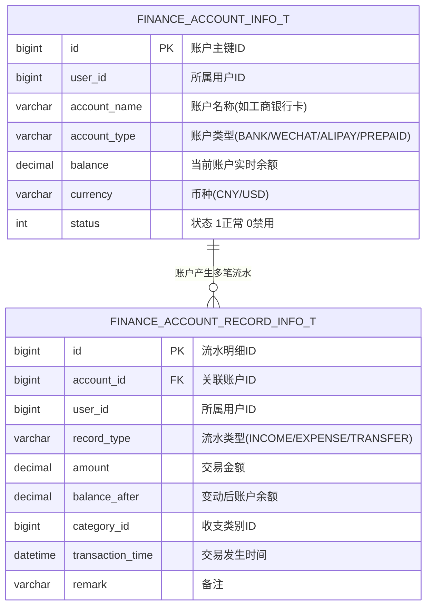

# 🛠️ TechSpec - 收支核算与预付卡流水设计

返回功能说明：[[02-Features/05-SelfFinance-个人资产财务/PRD-个人资产与收支记账功能说明|PRD-个人资产与收支记账功能说明]]

---

## 1. 实体领域模型与核心表



---

## 2. 核心技术规格

### 2.1 账户转账与事务防并发处理

```java
@Transactional(rollbackFor = Exception.class)
public boolean transfer(TransferVo req, Long userId) {
    // 1. 悲观锁锁定源账户与目标账户，按账户ID从小到大锁定避免死锁
    Long firstId = Math.min(req.getFromAccountId(), req.getToAccountId());
    Long secondId = Math.max(req.getFromAccountId(), req.getToAccountId());
    
    financeAccountMapper.selectByIdForUpdate(firstId);
    financeAccountMapper.selectByIdForUpdate(secondId);
    
    // 2. 检查余额充足
    FinanceAccountInfo from = financeAccountMapper.selectById(req.getFromAccountId());
    if (from.getBalance().compareTo(req.getAmount()) < 0) {
        throw new BusinessException("账户余额不足");
    }
    
    // 3. 执行双边流水扣减与增加
    financeAccountMapper.updateBalance(req.getFromAccountId(), req.getAmount().negate());
    financeAccountMapper.updateBalance(req.getToAccountId(), req.getAmount());
    
    // 4. 插入两笔对称流水日志
    insertRecord(from, req.getAmount().negate(), "TRANSFER_OUT");
    insertRecord(to, req.getAmount(), "TRANSFER_IN");
    return true;
}
```

### 2.2 数据权限与多租户

所有个人财务与流水操作必须在 Service 层面强制传入 `userId = SecurityUtils.getLoginUserId()` 进行硬编码约束或使用 `@DataPermission(tableAlias = "f", userField = "user_id")` 进行 SQL 级行过滤，防止越权操作他人物料。

### 2.3 财务收支多维分析双柱核算架构

- **聚合计算规范**：日/月度收支走势分析中，收入（`income_amount`）与支出（`expense_amount`）独立通过 `CASE income_and_expenses WHEN 'income'/'expense' THEN amount ELSE 0 END` 聚合求和，解耦正负抵消。
- **前后端契约**：`AnalysisVo` 提供独立字段 `BigDecimal incomeAmount` 与 `BigDecimal expenseAmount`，保留 `amount` 保证历史向下兼容。
- **前端可视化呈现**：`barChart.vue` 提供双柱分组对比（收入绿色 `#10b981`、支出暖橙 `#f97316`），全面反映同一时间粒度下的资金流入与流出真实全貌。

### 2.4 历史单表随礼菜单下线与清理规范 (2026-09-19)

- **数据库级联清理**：
  - `t_menu_info`：逻辑删除主菜单（`id = 1810856881968091138`，`name: personalGift`，`path: /selfFinance/personalGift`）与详情菜单（`id = 1810856882504962050`，`name: personalGiftDetail`），置 `is_delete = 1`；
  - `t_permission_info`：逻辑删除权限项 `selfFinance:personalGift`（`id = 1810856883473846273`）；
  - `t_role_permission_info`：逻辑删除对应角色绑定记录（IDs: `28`, `29`）。
- **Redis 缓存失效与预热**：
  - 级联清除 `LoginKey:login:in:menu_all_tree` 全量共享菜单树；
  - 遍历清除各在线用户的 `LoginKey:login:in:permission_context:*` 权限上下文，保证用户刷新页面即刻生效。
- **前端废弃视图源码移除**：
  - 彻底删除 `alex_miaosha_front/src/views/finance/personalGift/` 目录，消除无用的冗余打包体积与历史维护负担。

### 2.5 零花钱月度预算与分类消费核算 (Ponytail极简/0-Cron Job架构 - 2026-10-08)

- **核心需求与原则**：
  - 用户按月设置零花钱额度（`budget_amount`）并可选限定生效类别列表（`category_codes`，如仅计入"餐饮,零食"等高频日常消费）；
  - 严格践行 **Ponytail** 哲学：坚决不引入每月1号0点数据复制的定时任务（0-Cron Job），拒绝无意义的空跑批与脏数据膨胀；
  - **读链路（Query-time Fallback）**：查询指定月份时，若当月无独立设置，则通过 `selectLatestBefore` 自动回溯继承历史最近月份的配置（`is_inherited = true`）；若无任何历史记录则预算为0；
  - **写链路（Lazy Snapshot）**：用户调整当月预算时，仅更新/插入当月的 `finance_budget_info` 记录（`year_month = :currentMonth`），历史月份快照绝对隔离不受污染；
  - **精准支出抵扣与防越权**：
    - 联动 `finance_info`（`financeManage`）的明细数据，支出按 `type_code IN (...)` 精准统计，自动排除内部转账（`type_code = '转账'`）；
    - 所有 ID 交互前端强保持 `string`、后端通过 `@JsonSerialize(using = Long2StringSerializer.class)` 序列化，杜绝前端精度丢失；
    - 接口层提供 `GET /finance-budget/status` 与 `POST /finance-budget/save`，并在 PC 端（`alex_miaosha_front`）与移动端（`alex_miaosha_mobile`）完成双端联动呈现；
    - **归属人（`belong_to`）双重防崩兜底契约**：前端未选中特定筛选人时优先自动传递当前登录用户 ID（`userStore.getUserInfo?.id`）；后端请求 DTO（`FinanceBudgetSaveReq`）解绑 `@NotNull` 硬校验，当入参为空时自动由 Service 拦截器从 HTTP 上下文 Token（通过 `userUtils.getUserId()` 内聚解析）智能解析，彻底杜绝 400 校验阻断。


### 2.6 家庭财务流水权限与属主对齐规约 (2026-10-13)

- **业务场景与权限矩阵**：
  - **全家流水查看**：家庭管理员（dmin / amily_admin）与普通家庭成员（amily_member / user）均拥有查看全家流水的权限。后端通过 FinanceInfoMapper 上的 @DataPermission(table = "finance_info", field = "belong_to", orgField = "", scope = DataPermissionScope.ORG_SHARED) 机制在同一机构（家庭组）内共享查询，超管无限制。
  - **编辑与删除**：
    - 超级管理员 / 家庭管理员：拥有全家所有流水的编辑与删除权限。
    - 普通家庭成员：仅拥有归属于本人（elongTo === currentUserId）的修改与删除权限；对其他家庭成员的流水仅可查看，禁止修改或删除。
- **后端服务防越权加固 (lex_miaosha_finance)**：
  - 在 FinanceInfoServiceImp#updateFinanceInfo 与 FinanceInfoServiceImp#deleteFinanceInfo 中增加 ssertCanModify 属主与角色断言；
  - 判定当前登录用户是否为超管（角色包含 super）或管理员（角色包含 dmin）；若为普通成员且待操作流水的 elongTo != currentUser.id，统一抛出 FinanceException.forbidden("无权修改/删除其他家庭成员的财务流水")，阻断直接发 HTTP 请求绕过 MyBatis-Plus 默认方法的越权风险；
  - ddFinanceInfo 在入参未显式指定 elongTo 时自动绑定为当前登录用户 ID；
  - 配套单元测试 FinanceInfoOwnershipTest.java 覆盖超管、管理员和普通成员的增/改/删 9 项契约分支，100% 绿灯。
- **PC 前端交互与权限对齐 (lex_miaosha_front)**：
  - 表格操作列：引入 canEditRecord 与 canDeleteRecord 判定，对他人流水将“编辑”按钮无缝切换为“查看”只读按钮，隐藏“删除”按钮；
  - 批量删除：表格 useRowSelection 配置 getCheckboxProps，当 canDeleteRecord(record) 为 false 时自动禁用复选框，禁止勾选他人流水进行批量删除；
  - 明细弹窗 inance-manager-detail：ModelInfo 扩展 
eadonly 支持；只读模式下表单置灰禁用、分类药丸点击阻断，仅展示“关闭”按钮并拦截 handleOk；
  - 配套单测 	ests/scope/finance-manager-permission.test.ts 锁定属主与角色判定契约。
- **移动端端到端一致性 (lex_miaosha_mobile)**：
  - FinanceCard.vue（canDelete）与 inanceManagerDetail（canEditRecord）逻辑与 PC 端及后端完全一致；
  - 移动端单测 	ests/permission/finance-manager-permission.test.ts 66/66 全部绿灯通过。


### 2.7 移动端财务核心页面架构解耦与千行文件治理 (2026-10-14)

- **治理背景**：移动端财务模块早期累积了三个超千行的庞大单文件（`budgetManage/index.vue` 1513 行、`financeManager/index.vue` 1537 行、`financeManagerDetail/index.vue` 1342 行），维护极其脆弱；
- **组件解耦重构**：
  1. **零花钱预算页 (`budgetManage`)**：
     - `components/BudgetAiAssistantCard.vue`：独立承载 AI 口语录入、测算与三档推荐采纳；
     - `components/BudgetCategorySelector.vue`：独立承载收支方向与分类药丸池点选；
     - `components/BudgetSimulationCard.vue`：独立承载实时试算进度条与风控预警卡片；
     - 主页面从 1,513 行瘦身至 394 行（缩减 74%）；
  2. **流水主列表页 (`financeManager`)**：
     - `composables/useFinanceFilter.ts`：纯逻辑抽离时间范围、快捷芯片（7天/当月/今年/自定义）、日期弹窗与参数组装；
     - `components/PocketMoneyCard.vue`：独立封装本月零花钱折叠小卡片与健康度圆点微环境；
     - 主页面从 1,537 行瘦身至 400 行以内（缩减 74%）；
  3. **记账录入与编辑页 (`financeManagerDetail`)**：
     - `components/FinanceCategoryGrid.vue`：独立封装九宫格分类选择、历史动态分类追加与自定义弹窗；
     - `components/FinanceKeypad.vue`：独立封装 4×4 底部记账虚拟键盘、防呆校验与多动作提交；
     - `types.ts`：规范抽离预设分类常量与接口契约；
     - 主页面从 1,342 行瘦身至 470 行左右（缩减 65%）。
- **工程收益**：
  - 移动端所有财务核心业务单文件均降至千行以内，全量单元测试（66/66）与 `npm run build` 全绿，0 报错。

### 2.8 个人财务全链路归拢与 Ponytail 零破损路由架构 (2026-10-14)

- **命名空间与代码目录统一 (selfFinance)**：
  - 将所有个人资产与记账组件集中在 `src/views/selfFinance/`（包含 `financeManager`, `financeAnalysis`, `accountRecordInfo`, `prepaidCardInfoT`, `prepaidConsumeRecordT`）；
  - `src/views/finance/` 彻底解耦，仅保留 B 端商户/店铺财务与进销存业务；
  - 菜单路径统一定义为 `/selfFinance/...`，权限码统一定义为 `selfFinance:...`。
- **Ponytail 3 行无感向后兼容契约**：
  - 在 `router/index.ts#getComponent` 中增加自动归一化逻辑：即便正式环境生产库仍返回历史的 `/src/views/finance/...` 路径，前端运行时自动无缝映射到 `/src/views/selfFinance/...`，彻底杜绝生产 404；
  - 在 `utils/permission/index.ts#canAccessPermission` 中增加 `selfFinance:` 与 `finance:` 权限码自动映射，杜绝缓存刷新延迟导致的权限拦截。
  - 菜单与权限配置已全量收敛至 ackend/alex_miaosha/doc/sql/alex_user.sql 统一维护（原独立补丁文件已清理）。

### 2.9 预付卡看板与流水解耦重构 (2026-10-14)

- **治理背景**：`src/views/selfFinance/prepaidCardInfoT/index.vue` 原为 927 行，将卡片轮播 Swipe、金额拆分显示、快捷充值/消费、流水记录流与长达 530+ 行的内嵌 LESS 样式全部混杂在单文件中；
- **组件解耦重构**：
  1. `config/index.ts`：导出 `getBalanceParts`（整数/小数拆分）、`getStatusLabel`（卡片状态）与 `getCategoryIcon` 工具函数；
  2. `components/PrepaidCardSwipe.vue`：独立承载消费卡 `<van-swipe>` 滑动、余额排版、空态与加载中卡片渲染及专属样式；
  3. `components/PrepaidTransactionList.vue`：独立承载交易流水列表、状态圆点、正负金额高亮及更多明细触发；
  4. 主页面 `index.vue`：瘦身至 280 行（缩减 70%），仅负责数据装载调度（`fetchData`）、卡片路由跳转与全局布局。

### 2.10 零花钱预算 AI 测算推荐与口语化指令解析契约规范 (2026-10-14)

- **业务场景与架构**：
  零花钱预算弹窗（`BudgetAiAssistantPanel.vue`）提供「智能测算」与「一句话指令解析」能力。后端微服务（`FinanceBudgetInfoController` / `FinanceBudgetAiService`）集成大模型（DeepSeek）并内置 100% 可用的规则兜底引擎（`isFallback: true`）。
- **前后端双向兼容契约护城河**：
  1. **指令解析请求 (`FinanceBudgetAiParseReq`)**：
     - 支持标准 `text` 字段，并通过 `@JsonAlias({"command"})` 与互补 setter 彻底兼容前端传参 `command` 字段，杜绝反序列化为 null 导致的 400 参数校验异常；
  2. **智能测算返回 (`FinanceBudgetAiRecommendVo`)**：
     - 规范提供 `conservativeAmount`、`flexibleAmount`、`recommendedAmount`、`historyMonthlyAverage`、`recommendedCategoryCodes` 与 `dailyLimitSuggest`（每日均摊建议）；
     - 同时内置兼容 getter（`getSavingAmount`、`getRelaxedAmount`、`getRecommendAmount`、`getAvgMonthlyExpense`、`getRecommendedCategories`），保证前端视图无论读取新旧字段均能 100% 正确展示三档推荐数值；
  3. **指令解析返回 (`FinanceBudgetAiParseVo`)**：
     - 规范提供 `budgetAmount`、`scopeMode`、`incomeAndExpenses`、`categoryCodes` 与 `parseSummary`；
     - 同时内置兼容 getter（`getHasBudget`、`getAmount`、`getHasCategories`、`getCategories`、`getReasoning`），确保弹窗回填（`apply-parsed-command`）逻辑无缝解析。
- **质量工程与单元测试保障**：
  - `FinanceBudgetAiServiceTest#testFrontendCompatibility` 绿灯锁定新旧字段双向映射契约。

### 2.11 通用 AI 智能记账多场景扩展与双路由引擎架构 (2026-10-19)

- **业务场景扩展**：
  将原本单一的礼金记账 AI 抽取扩展为全场景通用智能记账：
  1. **日常收支账单 (`DAILY_EXPENSE`)**：自然语言识别餐饮外卖、出行打车、购物、工资、理财收益等；
  2. **购物小票明细 (`SHOP_RECEIPT`)**：自动解析收银小票商户名、消费总额与商品条目明细清单 (`receiptItems`)；
  3. **预付卡储值与消费流水 (`PREPAID_CARD`)**：智能识别储值卡/会员卡刷卡与充值，自动模糊匹配当前用户正常状态的预付卡并绑定 `prepaidCardId` 与可用余额。
- **双路由引擎与可用性保证**：
  - **核心服务**：`UniversalFinanceAiService#parseLedger` 与 `POST /api/v1/finance-info/ai-parse`；
  - **AI 优先**：调用 DeepSeek / OpenAI 大模型深度语义抽取纯 JSON 结构体；
  - **规则兜底**：大模型超时、未配置密钥或断网时，100% 平滑降级至本地正则表达式与关键词分类词库抽取引擎，彻底杜绝白屏与记账阻塞。
- **前后端契约与 ID 精度安全**：
  - `UniversalFinanceAiParseVo` 中的 `prepaidCardId`、`belongTo` 统一通过 `@JsonSerialize(using = Long2StringSerializer.class)` 序列化为前端字符串，前端严格保持 `string` 类型，杜绝超大整数精度丢失；
  - 双端落地交互：PC 端 `FinanceAiParseModal.vue`（支持小票明细表预览与一键回填）+ 移动端 `FinanceAiSheet.vue`（一键识别并填入九宫格键盘与表单）。

### 2.12 智能记账与小票识别全链路 Midscene 冒烟测试套件 (2026-10-19)

- **测试金字塔与 L3 自动化落地**：
  为巩固智能记账前后端全链路稳定性，按照项目测试标准接入 `@midscene/web` + Playwright 冒烟套件：
  1. **PC 端（`scripts/midscene/run-smoke.mjs`）**：
     - `AI-FINANCE-PC-LEDGER-001`：日常记账主页 -> 弹窗唤起（`data-testid="btn-finance-ai-parse"`）-> 自然语言输入流水 -> 触发解析 -> 校验预览卡片金额/支出方向/支付方式 -> 一键填入表单 -> 断言抽屉金额输入框（`#form_amount`）准确回填 `128.5`；
     - `AI-FINANCE-PC-RECEIPT-002`：输入超市小票明细 -> 执行解析 -> 验证 `.receipt-items-table` 单品表格结构化展示 -> 断言多商品条目完整性；
  2. **移动端（`scripts/midscene/run-gift-smoke.mjs`）**：
     - `FINANCE-AI-MOBILE-LEDGER-001`：记账录入页面 -> 顶部胶囊（`data-testid="mobile-btn-open-ai-sheet"`）-> ActionSheet 示例填入解析 -> 一键应用 -> 验证 `hero-amount-val` 金额看板联动；
     - `FINANCE-AI-MOBILE-RECEIPT-002`：ActionSheet 切换小票模式 -> 文本解析 -> `.receipt-items-list` 单品列表与数量断言；
- **防脆弱性与工程护城河**：
  - 杜绝任意 `Thread.sleep` 或固定延时，全部基于 `page.waitForResponse` 拦截 `/finance-manager-info/ai/parse`；
  - 元素定位严格遵循 `data-testid` 规约；
  - 在 `tests/checklists/finance_ai_ledger.md` 同步锁定状态机与边界用例。

### 2.13 通用财务 AI 识别流式推送 (SSE) 与多阶段响应规约 (2026-10-19)

- **业务背景与交互痛点解决**：
  智能记账由于涵盖长文本大模型多场景推断、购物小票多单品提取以及关联预付卡模糊查询，传统的单一同步阻塞式 HTTP 请求会导致用户等待 1~3 秒且无感知反馈。通过引入 SSE 流式管道（Server-Sent Events），将处理生命周期精细化切片，向客户端实时分步推送执行进度与状态说明。
- **协议与接口规范**：
  - **接口端点**：`POST /api/v1/finance-info/ai-parse-stream`（声明 `produces = "text/event-stream"`）；
  - **载荷对象**：`UniversalFinanceAiStageVo`，包含字段：
    - `stage`: 阶段编码（`SCENE_ANALYSIS` -> `EXTRACTING_AMOUNT` -> `STRUCTURING_ITEMS` -> `MATCHING_ENTITIES` -> `COMPLETE` / `ERROR`）；
    - `progress`: 进度百分比数值（`15%` -> `40%` -> `70%` -> `90%` -> `100%`）；
    - `message`: 阶段状态文案（如「正在分析记账场景与语境特征...」）；
    - `partialData`: 当前阶段解析出的结构化快照 `UniversalFinanceAiParseVo`。
  - **事件类型**：
    - `event: stage`：各阶段演进事件；
    - `event: complete`：最终完成事件与全量结构化载荷。
- **高可用与确定性保底护城河**：
  - 主线程预取登录态与属主信息（`belongTo` / `belongToName`），杜绝子线程 `ThreadLocal` 丢失；
  - 大模型异常或超时时，流式管道平滑透明切换至 `LOCAL_REGEX_FALLBACK` 本地正则词典引擎，依然向客户端发送 100% 进度与有效解析结果，绝不悬挂客户端连接；
  - 客户端（PC/Mobile）如果遭遇网络代理或代理层不支持流式响应，自动静默降级为常规同步 POST `/ai-parse`，实现两道防线极致稳固。
- **双端微交互**：
  - **PC 端 (`FinanceAiParseModal.vue`)**：引入进度条与动态步骤指示，展示 `stageStatus.message` 并实时计算百分比；
  - **移动端 (`FinanceAiSheet.vue`)**：集成 `.stream-stage-card` 与触觉中枢 `triggerHaptic('light')`，在阶段跃迁时带来灵动轻快反馈，并在解析成功时触发 `triggerHaptic('success')`。


### 2.14 移动端 AI 记账悬浮球与流式思考打字机抽屉 (Mobile Copilot) (2026-10-20)

- **悬浮入口球 (MobileAiFloatingBubble.vue)**：
  - 右下角常驻悬浮入口，内嵌晶体图标与呼吸光晕环动效（pulseGlow）；
  - 支持触摸垂直拖拽与边缘吸附，Top 坐标安全区约束为 [60, screenHeight - 120]px，位移超过 5px 自动防点击误触；
  - 点击轻触反馈（	riggerHaptic('light')）并唤起记账抽屉。
- **抽屉流式打字机升级 (FinanceAiSheet.vue)**：
  - 新增 SSE 流式思考链与推理打字机（.stream-reasoning-card），配合 .typing-cursor 呼吸闪烁动效；
  - 进度条多阶段演进与阶段状态文字联动（10% -> 70% -> 90% -> 100%），阶段跃迁触发 	riggerHaptic('light')，解析成功触发 	riggerHaptic('success')；
  - 雪花 ID 防御：elongTo 与 prepaidCardId 强制规范化为 string 类型，杜绝 JS 64 位大数截断；
  - 支持流式异常自动平滑降级走同步 parseUniversalFinanceLedger 接口。
- **测试金字塔与契约防线**：
  - 在 	ests/checklists/mobile-ai-copilot.md 沉淀测试清单（元信息、七点法边界、状态机、不测理由）；
  - 编写 	ests/unit/mobileAiCopilot.test.ts 覆盖拖拽边界、场景推导、雪花 ID 安全、状态机与触觉反馈（14 项单测全部通过）。

### 2.15 个人资产与收支统计 (FinanceSummary) 多级缓存加速与内部转账对账闭环 (2026-10-22)

- **性能背景与优化诉求**：
  日常收支统计接口（`FinanceInfoServiceImp#getFinanceSummary`）是财务微服务最核心的高频分析看板入口，频繁被 PC 端控制台与移动端资产首页拉取。为降低对 MySQL 聚合查询的压力，同时保证毫秒级超快响应，正式接入 `MultiLevelCacheService`（Caffeine L1 + Redis L2）多级缓存加速。
- **多级缓存架构与 Key 命名规范**：
  - **L1 本地缓存**：Caffeine 本地内存，默认 TTL 60 秒，极大减轻高频轮询与重复请求对 Redis 网络 IO 的开销；
  - **L2 分布式缓存**：Redis 分布式缓存，默认 TTL 1800 秒（30 分钟），保证分布式多节点间的数据一致性；
  - **缓存 Key 规范**：
    `finance:summary:{belongTo}:{start}:{end}:{typeCode}:{typeCodes}:{name}`
    通过包含属主 ID（`belongTo`）与所有多维过滤维度，实现多家庭成员、不同属主用户之间的缓存空间绝对物理隔离。
- **双写失效与 Pattern 级精准清理**：
  - 在 `common_core` 的 `MultiLevelCacheService` 中扩展 `evictPattern(String patternKey)` 方法，支持按前缀模式同时失效本地 Caffeine 与分布式 Redis 缓存；
  - 在涉及流水变更的 4 大写操作入口（新增 `addFinanceInfo`、修改 `updateFinanceInfo`、删除 `deleteFinanceInfo`、批量导入 `importFinance`）完成事务提交后，自动触发：
    `evictSummaryCache(belongTo)` -> `multiLevelCacheService.evictPattern("finance:summary:" + belongTo + ":*")`；
    精准清除该属主名下的所有统计缓存，避免跨用户大面积缓存雪崩与误删。
- **内部转账调拨对账闭环**：
  - 资金在多账户间内部划转（`type_code = '转账'` 或 `transfer`）属于资产重组而非实际损益；
  - Mapper 聚合查询及 SQL 统计默认自动排除 `type_code = '转账'`，严禁其计入总收入、总支出及结余；
  - 即使单笔转账金额巨大，净结余（`totalBalance = totalIncome - totalExpense`）依然严格守恒。
- **自动化测试护城河**：
  - 新增专用单元测试 `FinanceSummaryMultiLevelCacheTest.java`，覆盖：
    1. L1 Caffeine 命中验证（无 L2/Mapper 穿透）；
    2. L1 失效时穿透命中 Redis L2 并回填 L1；
    3. 流水变更双写失效；
    4. 流水删除与批量导入双写失效；
    5. 内部转账调拨零侵入对账验证；
    6. 多家庭成员不同属主缓存空间严格隔离。

### 2.16 PC 端账单表格排版质感与收支分析看板空状态演进 (2026-10-26 P1 级落地)

- **账单流水表格金融等宽微排版 (FinanceManagerTable.vue)**：
  - 金额列升级为原生等宽金融字体栈（ui-monospace, SFMono-Regular, Menlo, Monaco, Consolas 等），结合 	abular-nums 彻底根除不同数字因字宽不均引发的表格左右晃动；
  - 符号微排版解耦：正负收支符号（.direction-symbol）与货币符号（.currency-symbol）采用不同字号与透明度层级，正负号沉稳排版，数值扫读速度翻倍；
  - 分类列（	ypeCode）全面统一接入生动 Emoji 语义芯片，悬浮呈现微上浮（	ranslateY(-1px)）与柔和阴影，保留点击穿透筛选能力。
- **收支分析看板图表空状态与数据清洗 (pieChart.vue & arChart.vue)**：
  - 柱状图日度/月度收支走势增加真实收支数据校验，当全为 0 时优雅触发 <a-empty> 兜底展示，消除光秃秃的 31 天空坐标轴；
  - 环形图空状态内联对齐，消除 NaN 与空白渲染异常。
- **当月储蓄率与超支赤字边界强化 (FinanceAnalysisKpiRow.vue)**：
  - 针对收入为 0 且支出大于 0 的极端边界场景，储蓄率文案由生硬的 .0% 优化为具有警示感知的 超支赤字 并标红 	ext-danger，提升财务风控感知。
- **质量工程与单测锁死 (inanceAnalysisTaste.test.ts)**：
  - 5 项单测 100% 覆盖储蓄率超支赤字计算、0 边界、柱状图空数据判定契约；PC 端全量 25 个测试套件（120 Vitest + 21 Node）100% 通过。