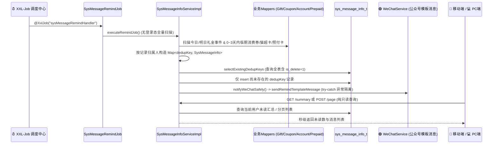

# 📐 TechSpec - 系统消息与多业务幂等巡检架构

返回首页：[[Home|知识库首页]] | 需求文档：[[02-Features/09-Message-消息与到期提醒中心/PRD-系统消息与多业务到期提醒中心功能说明|PRD-系统消息与多业务到期提醒中心]]

---

## 1. 架构设计与数据流转

采用 **100% XXL-Job 后台定时任务巡检 + `dedup_key` 唯一键防重落库 + 微信公众号模板消息联动推送架构**：
- **后台定时驱动（唯一生成通道）**：通过 `SysMessageRemindJob` 注册 `@XxlJob("sysMessageRemindHandler")`（并联动 `AccountRecordNoticeJob` 的 `@XxlJob("accountRecordNoticeHandler")`），在无登录态的后台线程中调用 `SysMessageInfoService.executeRemindJob()` 全量扫描礼尚往来事件（提前1天/当天）、未核销消费券、猫超卡及预付卡到期记录，按记录归属人（`user_id` / `org_id` / `creator`）精准生成站内提醒消息；`doc/sql/xxl_job.sql` 已预置 `xxl-finance-dev` 与 `xxl-finance-prod` 执行器组及每日 `08:30`（`0 30 8 * * ?`）自动调度的 `sysMessageRemindHandler` 任务记录；
- **微信模板消息联动（异常隔离）**：当 `persistCandidates()` 将尚未存在的新提醒 `insert` 入库成功后，立即调用 `notifyWeChatSafely(entity)` 联动 `WeChatService.sendRemindTemplateMessage(itemName, numText, remindType)` 推送微信公众号模板消息（复用 `accountTimeOutTemplateId` 模板的 `account` / `num` / `type` 变量）。微信推送包裹在 `try-catch` 中，任何网络或微信配置异常仅记录 `log.warn` 日志，绝不回滚站内信入库事务；
- **查询接口零副作用**：`GET /sys-message-info/summary` 与 `POST /sys-message-info/page` 保持纯只读查询，前端仅展示与操作消息，已移除手动巡检按钮。

---

## 2. 数据库表结构 (`sys_message_info_t`)

位于 `alex_finance` 库（定义于 `doc/sql/alex_finance.sql`，并在 `SysMessageInfoServiceImpl` 内置 `ensureTableExists()` 自愈建表兜底）：

- **核心字段**：
  - `id` (`bigint` PK)：雪花算法主键，VO 层通过 `@JsonSerialize(using = Long2StringSerializer.class)` 转字符串；
  - `org_id` / `user_id` (`bigint`)：归属机构与接收用户 ID；
  - `msg_type` (`varchar(32)`)：`SYSTEM` / `GIFT_EVENT` / `GIFT_RETURN` / `COUPON_EXPIRE` / `CARD_EXPIRE`；
  - `sub_type` (`varchar(32)`)：`WELCOME` / `ANNOUNCE` / `D_DAY` / `D_MINUS_1` / `D_MINUS_3`；
  - `priority` (`varchar(16)`)：`HIGH` / `MEDIUM` / `NORMAL`；
  - `biz_id` / `biz_type` / `jump_url`：关联业务主键、业务类型（`GIFT_EVENT` / `GIFT_RETURN` / `COUPON` / `ACCOUNT_RECORD` / `PREPAID_CARD` / `SYSTEM`）与跳转路由；
  - `read_status` (`tinyint(1)`)：`0`-未读，`1`-已读；
  - `dedup_key` (`varchar(128)` UNIQUE)：唯一幂等防重键，格式为 `{bizType}:{bizId}:{subType}:{remindDate}:{userId}`。

> [!IMPORTANT]
> **防复活关键设计**：`SysMessageInfoMapper.xml` 中的 `selectExistingDedupKeys` **故意不加 `is_delete = 0` 条件**。这样当用户主动左滑删除某条到期提醒后，原记录 `is_delete = 1` 仍保留该 `dedup_key`，后续巡检时不会重复生成骚扰用户，也不会重复发送微信模板消息。

---

## 3. 后端 API 契约 (`/api/v1/sys-message-info`) 与防越权安全基线

| 方法与路径 | 说明 | 核心入参 | 返回类型 | 安全与防御规约 |
| :--- | :--- | :--- | :--- | :--- |
| `POST /page` | 分页查询消息列表（纯只读查询，按未读优先 + 优先级 + 创建时间倒序） | `pageNum`, `pageSize`, Body: `SysMessageInfoVo` | `Result<Page<SysMessageInfoVo>>` | 强制根据当前用户与机构过滤，超管可按指定条件查询 |
| `GET /summary` | 获取当前用户未读消息汇总（纯只读查询，含系统/事件/回礼/券/卡五大分类未读数） | 无 | `Result<SysMessageSummaryVo>` | 包含 `giftReturnUnread` 独立统计，不混入 `systemUnread` |
| `PUT /read` | 标记单条消息已读 | `@RequestParam id` | `Result<Boolean>` | 严格防水平越权：普通用户访问他人或他机构消息直接抛出 403 Forbidden；已删除或不存在抛 PARAM 异常 |
| `PUT /read-all` | 一键全部标为已读（可按 `msgType` 过滤） | `@RequestParam(required=false) msgType` | `Result<Integer>` | 仅更新当前登录用户且当前机构的未读记录 |
| `POST ""` | 发布系统通知或个人备忘提醒 | Body: `SysMessageInfoVo` | `Result<SysMessageInfoVo>` | 防提权与身份防伪：非超管用户发布强制锁定为当前操作人 `userId` 与所属 `orgId`，严禁伪造他人身份或发布全员广播 |
| `DELETE ""` | 批量逻辑删除消息 | `@RequestParam ids` | `Result<Boolean>` | 参数防呆与越权防御：非数字字符串/空参数拦截友好报错杜绝 500；逐条校验归属权，越权抛 403 |

---

## 4. 双端前端工程落地与护城河

1. **ID 安全护城河**：
   - 移动端 `src/views/message/api/index.ts` 与 PC 端 `src/views/message/api/index.ts` 均内置 `normalizeMessageIds`，递归将所有 `id` / `*Id` 字段强制转为 `string`。
2. **移动端实现 (`alex_miaosha_mobile`)**：
   - `src/store/modules/tabbar/index.ts` 与 `src/components/common/TabBar.vue` 新增 `badges` 与 `setTabBadge(name, badge)` 支持；
   - `src/views/message/index.vue` 采用 `useNavBar` 响应式配置、`@/utils/dayjs` 统一时间工具、`onMounted` 生命周期初始化及 `navigator.vibrate` 触觉反馈（已移除手动巡检按钮，100% 由后台 XXL-Job 驱动）。
3. **PC 端实现 (`alex_miaosha_front`)**：
   - `src/layout/components/my-right-info/index.vue` 对接 `getSysMessageSummary()` 实时渲染顶栏铃铛未读角标；
   - `src/layout/components/my-right-info/components/MessageCenterDrawer.vue` 提供完整分类筛选、搜索、已读、删除、新增提醒与路由直达闭环（已移除手动「实时巡检」按钮）。

---

## 5. AI / E2E 自动化测试契约与 `data-testid` 矩阵

遵循项目金字塔测试体系与 Playwright + Midscene 规约：

1. **PC 端用例集 (`tests/midscene/message/cases/message-smoke.json`)**：
   - `MESSAGE-PC-SMOKE-001`：顶栏铃铛未读角标展示、点击滑出抽屉、分类 Tab 切换与未读统计断言；
   - `MESSAGE-PC-SMOKE-002`：消息中心抽屉新增自定义提醒弹窗表单校验与取消闭环；
   - 核心 DOM 挂载：`pc-header-btn-notification`、`pc-message-drawer`、`pc-message-tab-{key}`、`pc-message-btn-read-all`、`pc-message-btn-publish`、`pc-message-list`。
2. **移动端用例集 (`tests/midscene/message/cases/message-mobile-smoke.json`)**：
   - `MESSAGE-MOBILE-SMOKE-001`：底部导航 `tab-message` 点击进入 `/message` 页面与未读概览卡片加载；
   - `MESSAGE-MOBILE-SMOKE-002`：分类胶囊横向切换、仅看未读过滤与列表/空状态断言；
   - 核心 DOM 挂载：`tab-message`、`mobile-message-center`、`mobile-message-tab-{key}`、`mobile-message-toggle-unread`、`mobile-message-list`、`mobile-message-empty`。
3. **等待与数据隔离护城河**：
   - 严禁 `Thread.sleep` 或 `page.waitForTimeout`，统一采用 `page.waitForResponse(url => url.includes('/sys-message-info/'))` 或 `getByTestId().waitFor({ state: 'visible' })` 精确响应拦截。
