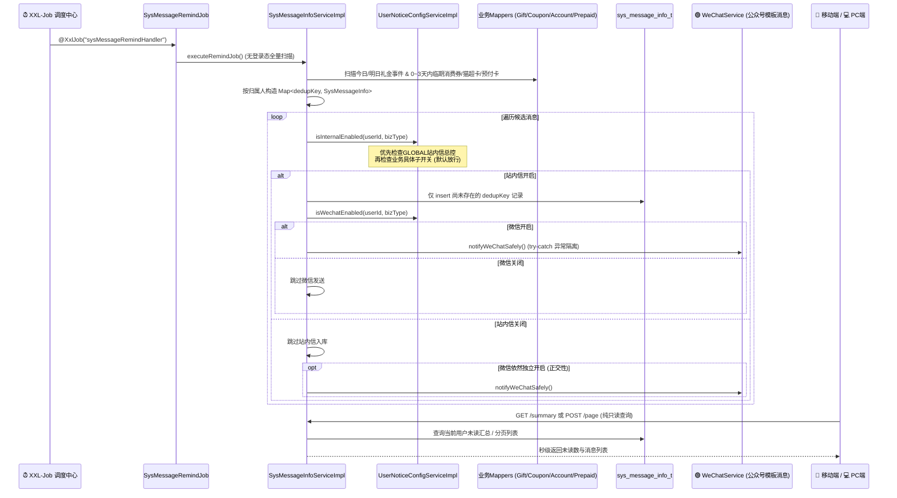

# 📐 TechSpec - 系统消息与多业务幂等巡检架构

返回首页：[[Home|知识库首页]] | 需求文档：[[02-Features/09-Message-消息与到期提醒中心/PRD-系统消息与多业务到期提醒中心功能说明|PRD-系统消息与多业务到期提醒中心]]

---

## 1. 架构设计与数据流转

采用 **100% XXL-Job 后台定时任务巡检 + `dedup_key` 唯一键防重落库 + 用户个性化推送渠道拦截 + 微信公众号模板消息联动推送架构**：
- **后台定时驱动（唯一生成通道）**：通过 `SysMessageRemindJob` 注册 `@XxlJob("sysMessageRemindHandler")`（并联动 `AccountRecordNoticeJob` 的 `@XxlJob("accountRecordNoticeHandler")`），在无登录态的后台线程中调用 `SysMessageInfoService.executeRemindJob()` 全量扫描礼尚往来事件（提前1天/当天）、未核销消费券、猫超卡及预付卡到期记录，按记录归属人（`user_id` / `org_id` / `creator`）精准生成站内提醒候选集；
- **用户个性化渠道判定与一票否决**：
  - **站内信入库前判定**：`persistCandidates()` 针对每条候选消息调用 `UserNoticeConfigService.isInternalEnabled(userId, bizType)`，若用户关闭站内信通道，则跳过入库；
  - **微信模版消息发送前判定**：`notifyWeChatSafely()` 针对每条已入库消息调用 `UserNoticeConfigService.isWechatEnabled(userId, bizType)`，若用户关闭微信通道，则跳过调用 `WeChatService`；
  - **GLOBAL 总控一票否决权**：若用户的 `GLOBAL` 开关为关闭，对应渠道的所有具体子业务即便开启也必须被一票否决；
- **微信模板消息联动（异常隔离）**：当站内信持久化成功且微信开关开启时，联动 `WeChatService.sendRemindTemplateMessage(itemName, numText, remindType)`。微信推送包裹在 `try-catch` 中，网络或配置异常仅记录 `log.warn`，绝不回滚站内信事务。



---

## 2. 数据库表结构设计 (`alex_finance`)

### 2.1 系统消息表 (`sys_message_info_t`)
位于 `alex_finance` 库（定义于 `doc/sql/alex_finance.sql`）：
- **核心字段**：
  - `id` (`bigint` PK)：雪花算法主键，VO 层通过 `@JsonSerialize(using = Long2StringSerializer.class)` 转字符串；
  - `org_id` / `user_id` (`bigint`)：归属机构与接收用户 ID；
  - `msg_type` (`varchar(32)`)：`SYSTEM` / `GIFT_EVENT` / `GIFT_RETURN` / `COUPON_EXPIRE` / `CARD_EXPIRE`；
  - `sub_type` (`varchar(32)`)：`WELCOME` / `ANNOUNCE` / `D_DAY` / `D_MINUS_1` / `D_MINUS_3`；
  - `priority` (`varchar(16)`)：`HIGH` / `MEDIUM` / `NORMAL`；
  - `biz_id` / `biz_type` / `jump_url`：关联业务主键、业务类型（`GIFT_EVENT` / `GIFT_RETURN` / `COUPON` / `ACCOUNT_RECORD` / `PREPAID_CARD` / `SYSTEM`）与跳转路由；
  - `read_status` (`tinyint(1)`)：`0`-未读，`1`-已读；
  - `dedup_key` (`varchar(128)` UNIQUE)：唯一幂等防重键，格式为 `{bizType}:{bizId}:{subType}:{remindDate}:{userId}`。

> [!IMPORTANT]
> **防复活关键设计**：`SysMessageInfoMapper.xml` 中的 `selectExistingDedupKeys` **故意不加 `is_delete = 0` 条件**。用户主动删除消息后，原记录 `is_delete = 1` 仍保留该 `dedup_key`，后续巡检绝不重复复活骚扰用户。

### 2.2 用户个性化推送渠道配置表 (`user_notice_config_t`)
```sql
CREATE TABLE IF NOT EXISTS `user_notice_config_t` (
  `id` BIGINT NOT NULL AUTO_INCREMENT COMMENT '主键ID',
  `user_id` BIGINT NOT NULL COMMENT '用户ID',
  `notice_code` VARCHAR(32) NOT NULL COMMENT '业务通知分类编码 (NoticeBizType)',
  `internal_enabled` TINYINT(1) NOT NULL DEFAULT 1 COMMENT '系统内部站内信开关 (1-开启 0-关闭)',
  `wechat_enabled` TINYINT(1) NOT NULL DEFAULT 1 COMMENT '微信服务号推送开关 (1-开启 0-关闭)',
  `creator` BIGINT DEFAULT NULL,
  `create_time` DATETIME DEFAULT CURRENT_TIMESTAMP,
  `updater` BIGINT DEFAULT NULL,
  `update_time` DATETIME DEFAULT CURRENT_TIMESTAMP ON UPDATE CURRENT_TIMESTAMP,
  `operator` BIGINT DEFAULT NULL,
  `operate_time` DATETIME DEFAULT CURRENT_TIMESTAMP ON UPDATE CURRENT_TIMESTAMP,
  `deleter` BIGINT DEFAULT NULL,
  `delete_time` DATETIME DEFAULT NULL,
  `is_delete` TINYINT DEFAULT 0,
  PRIMARY KEY (`id`),
  UNIQUE KEY `uk_user_notice` (`user_id`, `notice_code`, `is_delete`)
) ENGINE=InnoDB DEFAULT CHARSET=utf8mb4 COMMENT='用户消息通知渠道个性化配置表';
```

---

## 3. 业务分类字典枚举 (`NoticeBizType`)

```java
public enum NoticeBizType {
    GLOBAL("GLOBAL", "全局通知总控", "一票否决：关闭后将静音所有业务通知"),
    GIFT_EVENT("GIFT_EVENT", "礼金大喜事提醒", "大喜事举办当日(D-Day)、前1天与前3天倒计时提醒"),
    GIFT_RETURN("GIFT_RETURN", "人情回礼预警", "亲友有喜事待还礼、礼金严重失衡回礼提醒"),
    COUPON("COUPON", "消费券到期提醒", "消费券到期当日(D-Day)、前1天与前3天过期预警"),
    PREPAID_CARD("PREPAID_CARD", "预付卡/猫超卡到期", "猫超卡、超市预付卡到期当日与临期预警"),
    BUDGET_OVER("BUDGET_OVER", "月度预算超支预警", "月度开销达到或超过设定预算上限时的风险预警"),
    FINANCE_REPORT("FINANCE_REPORT", "财务汇总分析推送", "每周/每月个人与家庭收支结余智能分析简报"),
    SYSTEM("SYSTEM", "基础系统公告与安全提醒", "系统升级维护、安全登录告警等平台系统级消息");
}
```

---

## 4. 后端 API 契约与防越权安全基线

### 4.1 消息中心核心接口 (`/sys-message-info`)
| 方法与路径 | 说明 | 核心入参 | 返回类型 | 安全与防御规约 |
| :--- | :--- | :--- | :--- | :--- |
| `POST /page` | 分页查询消息列表 | `pageNum`, `pageSize`, Body: `SysMessageInfoVo` | `Result<Page<SysMessageInfoVo>>` | 强制根据当前用户与机构过滤，超管可按指定条件查询 |
| `GET /summary` | 获取未读消息汇总 | 无 | `Result<SysMessageSummaryVo>` | 包含各分类独立统计 |
| `PUT /read` | 标记单条已读 | `@RequestParam id` | `Result<Boolean>` | 严格防水平越权：非本人记录抛 403 Forbidden |
| `PUT /read-all` | 一键全部标为已读 | `@RequestParam(required=false) msgType` | `Result<Integer>` | 仅更新当前登录人机构下的记录 |
| `POST ""` | 发布系统通知或个人备忘 | Body: `SysMessageInfoVo` | `Result<SysMessageInfoVo>` | 非超管用户强锁本人 `userId` |
| `DELETE ""` | 批量删除消息 | `@RequestParam ids` | `Result<Boolean>` | 逐条校验归属权，越权抛 403 |

### 4.2 用户消息渠道配置接口 (`/user-notice-config`)
| 方法与路径 | 说明 | 核心入参 | 返回类型 | 安全与防御规约 |
| :--- | :--- | :--- | :--- | :--- |
| `GET /my-configs` | 获取当前用户的 8 大业务通知配置 | 无 (从安全会话提取 `userId`) | `Result<List<UserNoticeConfigVo>>` | 内存合并返回完整 8 项；无 DB 记录时回退默认全部开启 (1, 1) |
| `PUT /save-my-config` | 保存/更新用户特定业务通知配置 | Body: `UserNoticeConfigVo` | `Result<Boolean>` | 强锁登录态 `userId`，校验 `noticeCode` 合法性，Upsert 写入 |

---

## 5. 双端前端工程落地与护城河

1. **ID 安全护城河**：
   - 移动端与 PC 端 `src/views/message/api/index.ts` 均内置 `normalizeMessageIds`，递归将所有 `id` / `*Id` 强制转为 `string`。
2. **PC 端 Tailwind CSS 偏好抽屉 (`UserNoticeConfigDrawer.vue`)**：
   - 宽度 `560px`，完全采用 Tailwind CSS 原子类构建；
   - 顶部呈现全局总控渐变卡片，包含「一票否决」标识与站内信/微信总开关；
   - 7 大业务子项卡片支持双渠道独立控制，当总控关闭时下级子开关自动置灰禁用并提供友好 Tooltip 提示；
   - 采用乐观更新机制，变更即时响应，网络异常平滑回滚。
3. **AI / E2E 自动化测试标桩**：
   - 核心 DOM 挂载全套标准 `data-testid`：`pc-message-btn-notice-config`、`notice-config-global-card`、`switch-internal-GLOBAL`、`switch-wechat-GLOBAL`、`notice-item-{code}`、`switch-internal-{code}`、`switch-wechat-{code}`。

---

## 6. 测试金字塔与验收矩阵

- **Level 2 集成测试套件 (`alex_miaosha_finance`)**：
  1. `UserNoticeDefaultPolicyIT` (2 用例 PASS)：新用户全放行策略与全量 8 项合并；
  2. `UserNoticePersonalizedOverrideIT` (3 用例 PASS)：单用户关闭覆盖、巡检时微信跳过与站内信跳过；
  3. `UserNoticeGlobalOverrideSecurityIT` (4 用例 PASS)：GLOBAL 站内信/微信一票否决权与安全参数防御；
  4. `SysMessage*` 核心服务测试集 (33 用例 PASS)：状态机、幂等、越权拦截、汇总统计与 VO 序列化契约；
- **全栈单测覆盖**：
  - 后端：42/42 PASS (100%)
  - PC 端：26 套件 144 PASS (100%)
  - 移动端：28 套件 159 PASS (100%)
- **前端静态类型**：`pnpm type-check` (`vue-tsc --noEmit`) 0 报错通过。

---

## 7. 双端自动化 E2E 冒烟巡检与渠道偏好落地验收战报

### 7.1 PC 端自动化 E2E 冒烟套件 (`MESSAGE-PC-SMOKE-001/002`)
- **执行脚本**：`scripts/playwright/run-domain-ai-smoke.mjs`
- **用例落地**：
  1. `MESSAGE-PC-SMOKE-001`：验证顶部导航栏未读铃铛、未读气泡徽标、点击展开通知中心抽屉（`MessageCenterDrawer.vue`）、分类 Tab 切换与一键全部标为已读；
  2. `MESSAGE-PC-SMOKE-002`：从消息中心直接唤起 560px 消息渠道偏好抽屉（`UserNoticeConfigDrawer.vue`）、验证全局总控卡片（`GLOBAL`）站内信/微信一票否决权与 8 大业务子项开关联动。
- **验收结果**：**23/23 用例 100% 绿灯 PASS**。

### 7.2 移动端自动化 E2E 冒烟套件 (`MESSAGE-MOBILE-SMOKE-001/002`)
- **执行脚本**：`scripts/playwright/run-mobile-ai-smoke.mjs`
- **用例落地**：
  1. `MESSAGE-MOBILE-SMOKE-001`：验证移动端消息中心首页（`views/message/index.vue`）、未读统计总数徽标、分类胶囊过滤及全部已读交互；
  2. `MESSAGE-MOBILE-SMOKE-002`：右上角设置按钮唤起渠道偏好设置 Popup 弹窗、验证站内信/微信开关交互与修改后乐观反馈。
- **验收结果**：**16/16 用例 100% 绿灯 PASS**。

### 7.3 工程踩坑与防御 SOP
1. **Ant Design Vue `<a-drawer>` Teleport 锚点机制**：
   - `<a-drawer>` 挂载的 `data-testid` 会被外层 portal 拦截，导致 Playwright 选择器超时。解决方案：在抽屉内部真实具有尺寸的根子容器上统一挂载 `data-testid="pc-message-drawer"`。
2. **状态码兼容性**：
   - 前后端交互时，统一采用 `if (code === '00000' || code === '200' || code === 200)` 进行双态成功判断，防止网关与 Mock 数据差异引发渲染异常。
3. **移动端 Vue 3 模板事件绑定拼写**：
   - 严禁模板 `@saved="fetchSummary"` 与 script `loadSummary` 不一致导致的 Property access warn。
